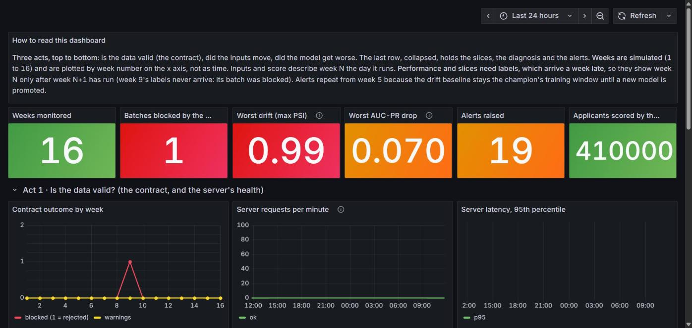
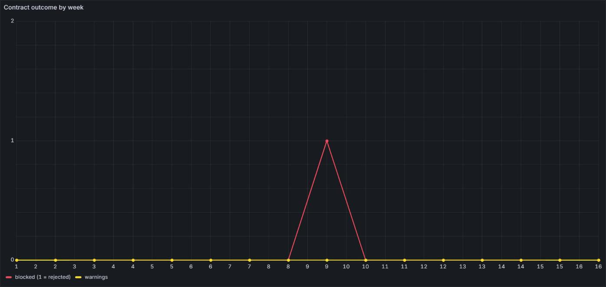
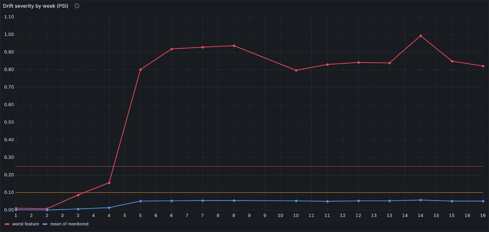
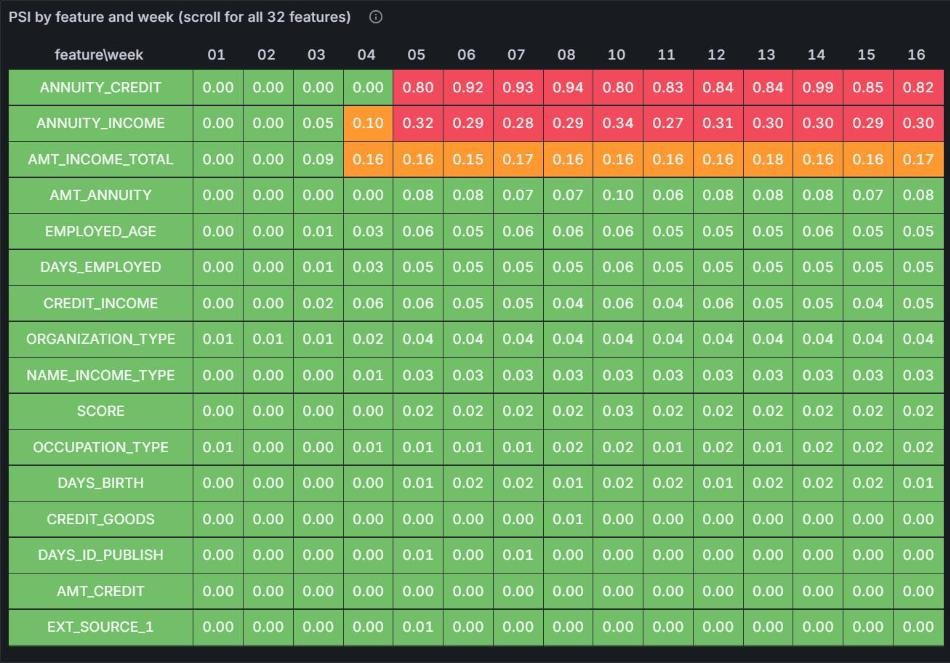
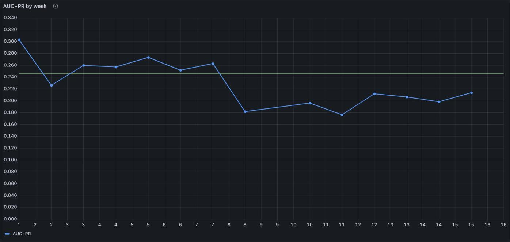
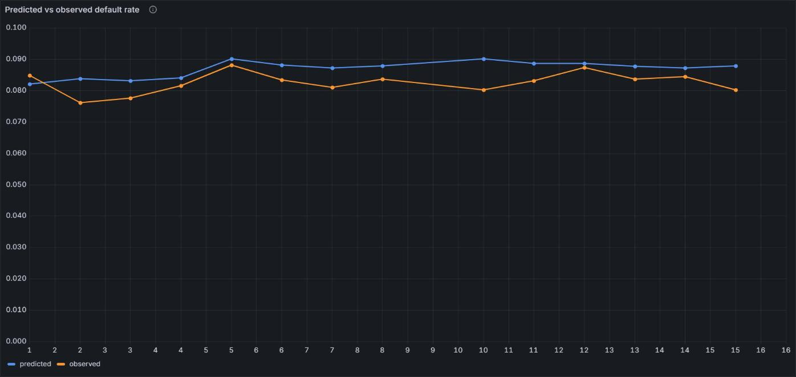
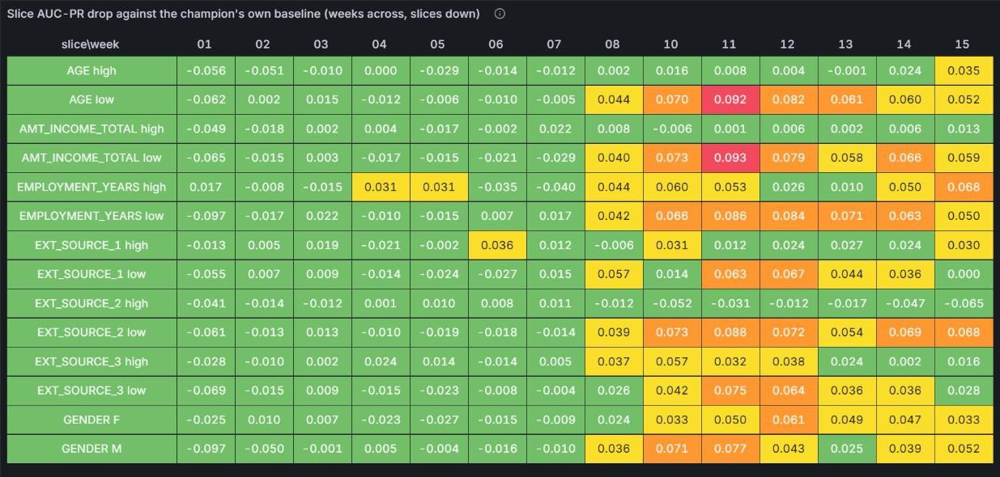
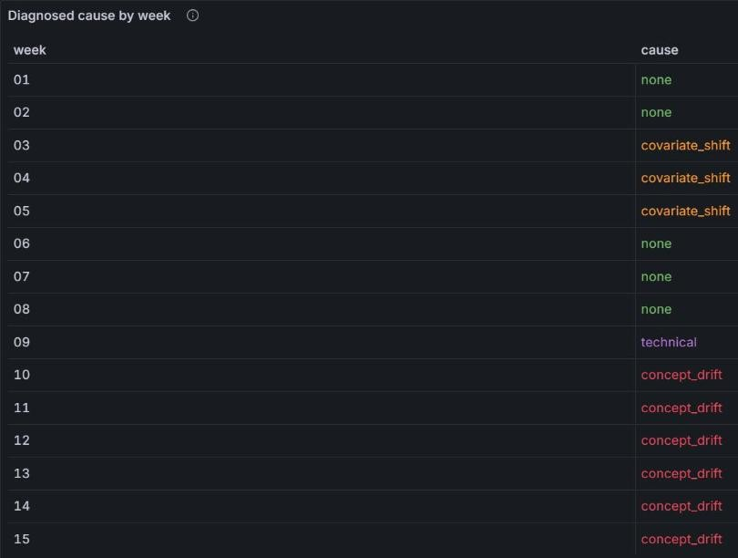
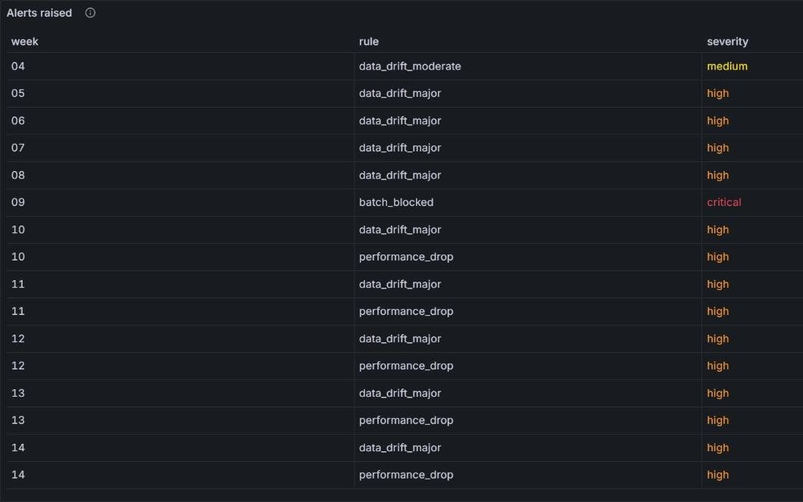

# credit-drift

Camada de sustentação e confiabilidade (contratos de dados, detecção de drift, observabilidade e governança LGPD) em torno de
um modelo de credit scoring. Projeto do Tech Challenge, Fase 4 (Pos Tech, Machine Learning Engineering).

## Em resumo (STAR)

- **Situação.** Um modelo de crédito em produção pode perder qualidade sem dar erro, depois de mudanças econômicas ou de
  perfil de clientes, e ninguém é avisado.
- **Tarefa.** Barrar dados ruins na entrada, detectar o drift e dizer qual das duas causas é, enxergar tudo em um painel e
  documentar a governança (LGPD).
- **Ação.** Simulamos 16 semanas de produção com problemas injetados em semanas conhecidas (Home Credit Default Risk) e
  construímos em volta de um modelo campeão: contratos de dados (Pandera e Great Expectations), detecção (Evidently, PSI),
  orquestração (Airflow), rastreio (MLflow, DVC), observabilidade (Prometheus e Grafana), análise causal, retreino com portão
  estatístico e plano de governança.
- **Resultado.** O contrato barrou o lote corrompido da semana 9. O PSI foi de 0,01 (semanas 1 e 2) para 0,80 na semana 5 sem
  que o desempenho caísse. O concept drift derrubou o AUC-PR de 0,246 para cerca de 0,19, e 0,07 disso as entradas não
  explicam. Nenhum dos 3 retreinos passou no portão.

### Reproduzir em poucos comandos

```bash
git clone https://github.com/JoaoFurlan/tech-challenge-04.git && cd tech-challenge-04
uv sync                                   # Python 3.14 e dependências travadas
# salve application_train.csv (Kaggle, Home Credit) em data/raw/  (detalhes: "Reprodução completa")
uv run python -m credit_drift.split && uv run python -m credit_drift.drift.simulate   # Referência/Produção e as 16 semanas
uv run python -m credit_drift.contracts.demo                                          # o contrato barra o lote corrompido
```

A pilha completa (MLflow, Airflow, Prometheus, Grafana) sobe com `docker compose`; veja [Reprodução completa](#reprodução-completa-e-operação).

### Mapa pela rubrica do Tech Challenge

| Critério (peso) | Onde está |
|---|---|
| **Validação de dados** (25%) | [Contrato de dados](#contrato-de-dados): Pandera na entrada e Great Expectations com Data Docs (`docs/reports/data_docs/index.html`); lote corrompido bloqueado (`uv run python -m credit_drift.contracts.demo`) e bloqueio no laço de produção (semana 9) |
| **Detecção de drift** (25%) | [Dados e simulação](#dados-e-a-simulação-de-drift) (cronograma e verdade em `docs/reports/drift_spec.json`), [Data drift e PSI](#data-drift-e-psi) (PSI, KS, qui-quadrado, JS com Evidently, relatórios HTML em `docs/reports/drift/`), [Concept drift e desempenho](#concept-drift-e-desempenho) e a calibração dos limiares |
| **Observabilidade e logs** (20%) | [Monitoramento semanal e painel](#monitoramento-semanal-e-painel-grafana), [Métricas de saúde operacionais](#métricas-de-saúde-operacionais), experimentos e registro no MLflow, DAGs no Airflow |
| **Governança (LGPD)** (15%) | [Governança e LGPD](#governança-e-lgpd) (dados pessoais, base legal, retenção, viés) e [Causalidade](#causalidade) |

Requisitos obrigatórios do desafio: pipeline de validação (contratos), scripts de simulação e detecção estatística de drift,
dashboards e relatórios HTML, governança consolidada neste README e histórico de commits semânticos. Boas práticas: Referência
e Produção separadas em arquivos distintos; mais de três regras rígidas de qualidade (idade 18–100, renda não nula e positiva,
sem IDs duplicados, esquema e tipos, valores positivos); relatório estatístico de mudança de distribuição (PSI e KS); plano de
privacidade.

**Índice.** Parte 1, a situação: [O problema](#o-problema-e-como-medimos) · [Glossário](#glossário-o-termo-técnico-em-palavras-simples-com-exemplo-e-número).
Parte 2, a ação: [Arquitetura](#arquitetura) · [Estrutura do repositório](#estrutura-do-repositório) · [Dados e simulação](#dados-e-a-simulação-de-drift) · [Modelo campeão](#modelo-campeão).
Parte 3, os resultados: [Contrato](#contrato-de-dados) · [Data drift](#data-drift-e-psi) · [Concept drift](#concept-drift-e-desempenho) · [Causalidade](#causalidade) · [Painel](#monitoramento-semanal-e-painel-grafana) · [Retreino](#retreino-e-recalibração) · [Governança](#governança-e-lgpd).
Parte 4, os impactos: [Conclusão](#conclusão-o-que-propusemos-e-o-que-encontramos) · [Decisões](#decisões-de-projeto) · [Trabalho futuro](#trabalho-futuro).
Parte 5: [Reprodução completa e operação](#reprodução-completa-e-operação).

---

# Parte 1 · Situação e tarefa

## O problema e como medimos

**O problema.** O modelo continua dando notas, mas elas ficam piores, e ninguém é avisado: não dá erro, só perde qualidade
(*model drift*). Há duas causas. **Data drift** (covariate shift): as entradas mudam, chegam clientes diferentes dos de
treino. **Concept drift**: os clientes parecem os mesmos, mas o risco mudou (com a inflação, R$ 5 mil já não significa o mesmo
risco). Um laço de monitoramento precisa separar as duas, porque a resposta é diferente: recalibrar ou retreinar ajuda num caso e
quase nada no outro.

**O que tentamos resolver.**

1. **Barrar** dados ruins antes que cheguem ao modelo (contratos de dados).
2. **Detectar** o drift e dizer qual das duas causas é (PSI, KS, AUC-PR e uma análise causal).
3. **Enxergar** tudo em um único painel (Prometheus, Grafana, Evidently).
4. **Documentar** a governança e a LGPD (retenção, base legal, viés).

**Como medimos: AUC-PR.** É o quanto o modelo põe os maus pagadores no topo da lista; se o número cai, o modelo degradou. Ao
acaso, vale a taxa de inadimplência (0,081); o nosso modelo marca **0,246**. Na prática, no limiar de decisão de 1/6, de cada
100 clientes barrados cerca de 26 não pagariam, contra 8 ao acaso. O limiar vem de uma regra de custo: um inadimplente não
detectado custa 5 vezes mais que um alarme falso (C_FN = 5 × C_FP), o que dá `1/(1+5) = 1/6`; é uma suposição que uma
instituição real substituiria pelos seus números. O AUC-PR é usado em vez da acurácia porque só cerca de 8% dos clientes não
pagam.

## Glossário: o termo técnico, em palavras simples, com exemplo e número

Cada termo abaixo segue a mesma ordem: o nome técnico, o que é em linguagem simples, um exemplo e o que ele mostrou neste projeto.

| Termo técnico | Em palavras simples | Exemplo | No nosso projeto (número e impacto) |
|---|---|---|---|
| **Model drift** (degradação silenciosa) | o modelo continua dando notas, mas elas ficam piores, e ninguém é avisado | uma renda de R$ 5 mil passa a valer menos com a inflação | o AUC-PR cai de 0,246 para cerca de 0,19 nas semanas de concept drift |
| **Data drift** (covariate shift) | os clientes que chegam são diferentes dos de treino | a renda média cai de R$ 167 mil para R$ 145 mil | PSI da renda de 0,00 para 0,16 na semana 5; nessa fase o desempenho não caiu (0,261 observado contra 0,262 esperado só pelas entradas) |
| **Concept drift** | os clientes parecem os mesmos, mas o que cada perfil significa para o risco mudou | "score externo alto é seguro" deixa de valer para um grupo | em 26% dos clientes o efeito de `EXT_SOURCE_2` foi invertido e reduzido à metade; PSI e KS não mudam, e o AUC-PR vai de 0,246 para 0,192, quando as entradas sozinhas dariam 0,262 |
| **PSI** (Population Stability Index) | mede o quanto a distribuição de uma variável mudou: abaixo de 0,10 estável, acima de 0,25 mudança forte | a renda média de um mês contra a do treino | semanas de controle: no máximo 0,012; semana 5: 0,80 na razão parcela/crédito |
| **KS** (Kolmogorov–Smirnov) | a maior distância entre duas distribuições acumuladas | quanto o gráfico acumulado da renda de hoje se afasta do de treino | evidência complementar ao PSI; com 5.000 linhas por semana o ruído é de cerca de 0,02 |
| **AUC-PR** | o quanto o modelo põe os maus pagadores no topo da lista; ao acaso, vale a taxa de inadimplência | de 100 clientes barrados, quantos realmente não pagariam | 0,081 ao acaso contra 0,246 (teste da Referência); no limiar de decisão, de cada 100 barrados 26 não pagariam, contra 8 ao acaso |
| **Brier** | o erro médio das probabilidades previstas; mede se dá para confiar nelas | o modelo diz 20% e cerca de 20% do grupo de fato não paga | 0,068, melhor que o palpite constante de 0,0745 |
| **Calibração** | a probabilidade prevista bate com a taxa observada | previsto 8% e observado 8% | semana 5: previsto 0,090 e observado 0,088 (diferença de 2%); em todas as semanas a diferença ficou abaixo do limite de alerta de 20% |
| **Data contract** (contrato de dados) | regras que o lote precisa cumprir para entrar no pipeline | idade entre 18 e 100 anos | o lote corrompido da semana 9 foi bloqueado; sem isso, 12% das notas sairiam sem renda |
| **Label delay** | o resultado (pagou ou não) só chega depois | um cliente só é "inadimplente" meses depois da concessão | 1 semana simulada; em produção seriam meses |
| **Contrafactual por reponderação** | pesar a base de treino para parecer com a produção e ver a nota esperada | "se os clientes de hoje tivessem o comportamento de ontem, qual seria a nota?" | esperado 0,262, observado 0,192: 0,070 (IC 95% 0,045 a 0,092) não são explicados pelas entradas |
| **Portão de promoção** (bootstrap pareado) | teste estatístico que decide se um modelo novo substitui o atual | só troca se o ganho de custo for provado com 95% de confiança | 3 tentativas, todas recusadas; em semanas novas o candidato ganha +0,011 de AUC-PR, que 5 mil clientes por semana não provam rápido |
| **Viés** (discriminação indireta) | o modelo erra mais para um grupo do que para outro, mesmo sem usar a característica | de 100 clientes que pagariam, 13 homens e 8 mulheres são barrados | homens sinalizados 1,61 vez mais (16,1% contra 9,9%) |
| **Pseudonimização** | usar um ID no lugar do nome | `SK_ID_CURR` em vez de nome e CPF | o ID já vem opaco do conjunto público; nenhuma linha de cliente em relatórios, logs ou MLflow |
| **Base legal** (LGPD, art. 7º) | a razão que a lei aceita para tratar o dado | executar o contrato de crédito | contrato (V) e proteção ao crédito (X) para o escore; legítimo interesse (IX) para monitorar |

---

# Parte 2 · Ação: o que construímos

## Arquitetura


Azul: armazenamento; preto: execução; laranja: observabilidade. As setas mostram quem chama quem. O Airflow orquestra três fluxos (treino, monitoramento semanal e retreino); cada caixa pode rodar em qualquer lugar. As
métricas seguem dois padrões de coleta, de propósito: o **push** (tarefas em lote do Airflow enviam ao Pushgateway, que o
Prometheus lê) e o **pull** (o Prometheus lê o `/metrics` do servidor, que é um serviço de longa duração).

| Componente | Para quê | Onde ver (pelo túnel SSH) |
|---|---|---|
| Airflow 3 | orquestra os três DAGs; as tarefas só chamam `python -m credit_drift...` | `http://localhost:8080` |
| MLflow + Postgres | experimentos, registro de modelos, linhagem (hash do conjunto de dados) | `http://localhost:5000` |
| Servidor do modelo (FastAPI) | serve o `credit_scoring@champion`; é chamado pelo DAG por HTTP | `http://localhost:8010` |
| Pushgateway e Prometheus | recebem e guardam as métricas | `http://localhost:9090` |
| Grafana | painel de toda a história de 16 semanas, provisionado como código | `http://localhost:3000` |
| DVC (remoto S3) | versiona os dados brutos, a Referência e as 16 semanas | `dvc status`, `dvc pull` |

Num ambiente real, a mesma cadeia existe, mas cada etapa é mais robusta: ingestão com contrato e data lake com acesso por perfil,
treino em computação elástica, registro com aprovação humana e model card, vários servidores com canário, monitoramento com
rótulos que levam meses, plantão com runbook e fallback para lotes bloqueados. Neste projeto, cada caixa é mais simples: um
servidor, um portão automático e rótulos em 1 semana.

## Estrutura do repositório

```
tech-challenge-04/
├── README.md                    # este arquivo
├── CLAUDE.md                    # decisões de arquitetura e convenções (inglês)
├── MLET - Tech Challenge - Fase 4.pdf   # o enunciado
├── pyproject.toml, uv.lock, .python-version   # dependências travadas (uv, Python 3.14)
├── docker-compose.yml           # Postgres, MLflow, servidor, Airflow, Pushgateway, Prometheus, Grafana
├── config/
│   ├── contract_profile.json    # perfil do contrato de dados
│   ├── monitored_features.json  # as 32 variáveis do relatório e das tabelas
│   └── monitoring_thresholds.json   # limiares congelados (decisão #16)
├── src/credit_drift/
│   ├── data.py, split.py        # leitura e divisão Referência/Produção
│   ├── contracts/               # Pandera, Great Expectations, regras, lote corrompido, demo
│   ├── drift/                   # cronograma, modelo de rótulos e simulador das 16 semanas
│   ├── training/                # features, modelos, busca (Optuna), campeão, MLflow
│   ├── monitoring/              # PSI/KS, relatório Evidently, alertas, diagnóstico, fatias, causal, viés, laço semanal
│   ├── retraining/              # janela, candidatos, portão de bootstrap, política, análise
│   └── serving/                 # app FastAPI e leitura do registro
├── dags/                        # training_pipeline, production_monitoring, retraining_pipeline
├── docker/                      # Dockerfiles, prometheus.yml, Grafana (build_dashboard.py, painel e provisionamento)
├── notebooks/                   # 01_eda, 02_retraining, 04_drift_evaluation (executados, com HTML em docs/reports)
├── tests/                       # 130 testes (contratos, simulação, treino, monitoramento, retreino, servidor, governança)
├── scripts/                     # sync-box.sh e make_readme_figures.py
├── data/
│   ├── raw/                     # application_train.csv (fora do git; ponteiro .dvc)
│   ├── reference.dvc, production.dvc   # ponteiros do DVC; os dados ficam no remoto S3
│   └── monitoring/              # tabelas geradas (ignorado pelo git)
└── docs/
    ├── decisions.md             # decisões numeradas (#8 a #19) com motivos e resultados
    ├── build-plan.md            # plano de implementação em passos
    ├── operations.md            # operação do servidor Linux, túnel SSH, backups
    ├── course-notes/            # notas de curso usadas como referência
    ├── calibration/             # JSONs de calibração, contrafactual e viés (verdade offline)
    ├── reports/                 # HTML: Data Docs, relatórios Evidently, notebooks; drift_spec.json
    └── img/                     # capturas do Grafana e dos slides, e a figura do contrafactual
```

Gerados e fora do git: `artifacts/` (saídas de treino), `reports/` (conjunto completo dos relatórios semanais), `gx/`
(contexto do Great Expectations), `mlruns/` e `mlartifacts/`.

## Dados e a simulação de drift

**Em palavras simples:** como não há uma fintech de verdade, criamos 16 "semanas" de clientes em que mexemos de propósito em
renda, parcela e na relação com o risco, sabendo exatamente o que foi alterado. **Exemplo:** na semana 5 a parcela sobe 15%.
**Impacto:** o PSI da razão parcela/crédito vai de 0,00 para 0,80, mas o desempenho não cai; só o concept drift (semana 8 em
diante) derruba o AUC-PR, de 0,246 para cerca de 0,19.

O conjunto de dados é o **Home Credit Default Risk** (`application_train.csv`, 307 mil linhas, classificação binária, 8,1% de
inadimplentes), só a tabela principal, sem os joins com as demais, para manter o foco no monitoramento e não na engenharia de
atributos. Ele é dividido em **Referência** (treino) e **Produção** (separada, sem sobreposição) em arquivos distintos. Os
dados de produção (100 mil linhas) são cortados em **16 semanas** de 5.000 clientes, e um estado de "mundo" é aplicado a cada
semana (`uv run python -m credit_drift.drift.simulate`; decisões em `docs/decisions.md`, seção 10). O tempo é sintético: os dados
não têm datas.


| Semanas | O que acontece |
|---|---|
| 1–2 | controle: nenhum drift (os detectores **não** devem disparar) |
| 3–4 | drift gradual de covariáveis: renda ×0,90 → ×0,86 e tempo de emprego ×0,92 → ×0,85; a mistura de tipos de renda começa a mudar |
| 5 | choque abrupto: parcela ×1,15 (a razão parcela/renda dispara) e mistura completa (pensionistas de 18% para 12%) |
| 6–7 | novo normal: o regime da semana 5 continua |
| 8, 10–16 | **drift de conceito**: para clientes até 45 anos com renda abaixo da mediana (≈26%), a relação de `EXT_SOURCE_2` com a inadimplência é invertida e reduzida à metade; nenhuma variável muda, **mas o deslocamento das entradas da semana 5 continua**: os dois problemas convivem até a semana 16 |
| 9 | lote corrompido (12% de rendas nulas, idades < 18, IDs duplicados, coluna numérica como texto): o contrato bloqueia o lote e os rótulos nunca chegam |

Cada semana gera um arquivo de *features* e outro de *rótulos* (em produção os rótulos chegam depois), e `drift_spec.json`
registra o que foi injetado: é o gabarito usado **apenas offline** (`docs/reports/drift_spec.json`). Cada semana tem sua própria
semente (base + semana) e um estado absoluto do mundo, não acumulado, então adicionar uma semana nunca muda as anteriores.

O que isso faz com o modelo campeão (resultado medido, não suposto):

- O drift de covariáveis mexe nas distribuições e na probabilidade média prevista (de 8,2% na semana 1 para
  9,0% na semana 5, e a inadimplência observada acompanha: de 8,5% para 8,8%, então não há descalibração), mas quase não muda o AUC-PR
  (0,251 → 0,238 só com o choque da parcela).
- O drift de conceito faz o contrário: nenhuma distribuição se mexe, mas o AUC-PR cai e o AUC-ROC vai de 0,76–0,78 para
  0,72–0,74. PSI e KS **não** veem isso; só o desempenho (com rótulos) mostra.
- Uma única semana de 5.000 clientes é ruidosa (intervalo de confiança do AUC-PR de ±0,04), por isso as métricas por fatia usam
  janelas de duas semanas.

## Modelo campeão

O treino roda em quatro etapas, cada uma um *experimento* do MLflow (`http://127.0.0.1:5000`), e o melhor resultado de uma etapa
alimenta a seguinte (decisões em `docs/decisions.md`, seção 8):

```bash
docker compose up -d                                  # MLflow + Postgres
uv run python -m credit_drift.training.run all        # ou: features | models | tune | select
```

| Experimento | O que compara | Resultado |
|---|---|---|
| `feature_engineering` | variantes A (bruta), B (engenhada), C (selecionada), cada uma com regressão logística e LightGBM | **B** vence (AUC-PR 0,2402 com LightGBM); C empata, mas custa mais; A é claramente pior (0,2333) |
| `model_selection` | regressão logística, LightGBM e XGBoost na variante B | LightGBM e XGBoost empatam (0,2402 e 0,2404); ambos seguem para o ajuste |
| `hyperparameter_tuning` | Optuna (TPE, 25 tentativas por família, poda de tentativas fracas) | LightGBM e XGBoost terminam empatados (AUC-PR 0,2462 na validação cruzada) |
| `champion` | regra de seleção, calibração, avaliação única no teste, registro | **variante B + LightGBM**, calibração de Platt |

**Regra de seleção** (aplicada em todas as etapas): ordenar por AUC-PR em validação cruzada de 3 partes, manter tudo que estiver
a até 1 erro-padrão do melhor e escolher o de menor **custo esperado** (C_FN = 5 × C_FP). O Brier é uma verificação de sanidade:
o modelo calibrado precisa superar a previsão constante da taxa de inadimplência.

**Resultado do campeão no conjunto de teste da Referência** (usado uma única vez, depois da escolha):

| Métrica | Valor |
|---|---|
| AUC-PR | 0,246 (IC 95%: 0,232–0,261); um modelo sem poder preditivo teria 0,081 |
| AUC-ROC | 0,760 |
| Brier calibrado | 0,0680 (constante: 0,0745) |
| Probabilidade média prevista | 8,09% (observada: 8,10%) |

Interpretação prática: os 10% de solicitantes com maior risco têm 27,9% de inadimplência (3,4 vezes a média) e concentram 34% de
todos os inadimplentes. Com o limiar de decisão de 1/6 (custo 5:1), o modelo sinaliza 12% dos solicitantes e captura 38,5% dos
inadimplentes, com 26% de precisão. O desempenho é moderado de propósito, pelo motivo acima. O modelo vencedor é registrado no
**MLflow Model Registry** com o alias `champion`, e é o único usado adiante (validação, pontuação e servidor).

---

# Parte 3 · Resultados

Cada seção segue o mesmo caminho: o que é, o que fizemos, o resultado, o impacto e onde ver. Os gráficos do Grafana são
capturas do painel provisionado (`docker/grafana/`), depois da execução de referência das 16 semanas.



## Contrato de dados

**Em palavras simples:** um contrato de dados são regras que o lote precisa cumprir antes de entrar; se uma regra de bloqueio
quebra, o lote inteiro é barrado. **Exemplo:** idade fora de 18 a 100 anos. **Impacto:** o lote corrompido da semana 9 (12% de
rendas nulas, idades menores que 18, IDs repetidos) foi barrado por Pandera e Great Expectations e nunca chegou ao modelo.

Toda carga de dados passa por dois validadores com papéis diferentes (regras em `src/credit_drift/contracts/`, decisões em
`docs/decisions.md`):

- **Pandera:** porta de entrada rápida (*fail fast*), só com as regras **bloqueantes**.
- **Great Expectations:** suíte completa, com regras bloqueantes e **avisos**, e geração do **Data Docs** (trilha de auditoria).

| Severidade | Regras | Efeito |
|---|---|---|
| Bloqueante | colunas e tipos esperados; `SK_ID_CURR` único e não nulo; renda não nula e > 0; idade entre 18 e 100 anos; `DAYS_EMPLOYED` ≤ 0 ou o código 365243; valores de crédito positivos (parcela ≥ 0) | O lote é rejeitado e não é pontuado |
| Aviso | renda acima de 10 milhões (tolerância de 0,1%); gênero fora de {F, M, XNA}; aumento de mais de 5 pontos na taxa de nulos de uma coluna; categorias nunca vistas; tamanho do lote | Registrado e alertado; o lote segue |

Há dois contratos: o do **lote de pontuação** (sem `TARGET`) e o dos **rótulos**, aplicado quando eles amadurecem (`TARGET`
binário, IDs únicos). Os resultados e o Data Docs registram apenas **contagens e percentuais**, nunca os valores que violaram a
regra (LGPD).

**Resultado.** O treino e um lote limpo passam; o lote corrompido da semana 9 (12% de rendas nulas, idades abaixo de 18 anos, 3% de
IDs duplicados e uma coluna numérica como texto) é rejeitado pelos dois validadores, vai para a quarentena, dispara um alerta
crítico e o modelo nunca o vê. Sem o contrato, 12% das notas seriam calculadas sem renda.



```bash
uv run python -m credit_drift.contracts.demo
```

**Onde ver:** Data Docs em `docs/reports/data_docs/index.html`; painel "Contract outcome by week" no Grafana; a quarentena em
`artifacts/monitoring/quarantine`. No mundo real um lote bloqueado teria um fallback (segurar as decisões, revisão manual ou
pontuar só as linhas válidas); aqui ele só é barrado.

## Data drift e PSI

**Em palavras simples:** a cada semana comparamos cada variável com a base de treino do campeão: o PSI diz o quanto mudou, o KS
dá a distância entre as distribuições e o Evidently gera o relatório. **Exemplo:** a renda média caiu de R$ 167 mil para
R$ 145 mil e o PSI da renda foi para 0,16. **Impacto:** isso mostra quais variáveis mudaram e dispara o alerta, mas não diz se o
modelo piorou.

Cada semana é validada pelo contrato e, se passar, pontuada pelo modelo campeão e comparada com duas bases
(`uv run python -m credit_drift.monitoring.run_drift`; decisões em `docs/decisions.md`, seção 11):

- a **Referência original** (informativa: quanto o mundo mudou desde o treino);
- a **janela de treino do campeão** (é a que dispara alertas; muda de lugar quando um novo modelo é promovido). Para o primeiro
  campeão as duas são os mesmos dados.

São medidos, para todas as colunas de entrada do modelo (inclusive as que ele mesmo cria, como a razão parcela/renda) e para o
**score**: PSI, KS (numéricas), qui-quadrado (categóricas) e distância de Jensen-Shannon. O **PSI** decide os alertas (faixas:
abaixo de 0,10 sem drift, 0,10–0,25 moderado, acima de 0,25 forte), porque com milhares de linhas o p-valor acusa qualquer
diferença, enquanto o PSI mede o tamanho da mudança. Valores ausentes têm faixa própria no PSI, e colunas numéricas com muitos
valores repetidos (61% das rendas estão em 8 números redondos) recebem uma perturbação de ±2% com semente fixa para que o PSI
não oscile conforme o valor cai na borda de uma faixa.

**Resultado.**

<table>
<tr>
<td></td>
<td></td>
</tr>
</table>

| Semanas | Variáveis monitoradas com PSI ≥ 0,10 | Leitura |
|---|---|---|
| 1–2 | 0 (máximo 0,012) | controle: os detectores ficam quietos |
| 3 | 0 (renda 0,086) | drift gradual ainda abaixo do limite |
| 4 | 2 (renda 0,156; parcela/renda 0,10) | primeiro alerta |
| 5–8, 10–16 | 3, duas delas fortes (parcela/crédito 0,80–0,94; parcela/renda 0,27–0,34) | o choque abrupto e o novo normal |
| 9 | lote bloqueado pelo contrato | sem pontuação e sem relatório |

Os relatórios HTML do **Evidently** (PSI, KS e qui-quadrado, 32 variáveis escolhidas por uma regra sobre a Referência, mais o
score) das semanas 1, 5 e 8 estão em `docs/reports/drift/`.

**Por que cada relatório tem dois quadros "Dataset Drift", com números diferentes.** São dois testes sobre as mesmas 33 colunas
(32 variáveis mais o score), e cada um tem a sua régua; o relatório traz uma caixa "Como ler" no topo com a mesma explicação.

| | Primeiro quadro: **PSI** | Segundo quadro: **KS e qui-quadrado** |
|---|---|---|
| O que mede | o **tamanho** da mudança: divide a variável em 10 faixas de mesma frequência na base e compara a fração de linhas em cada faixa, PSI = soma de (atual − base) × ln(atual ÷ base) | se a diferença **existe**: o KS é a maior distância vertical entre as curvas acumuladas (numéricas); o qui-quadrado compara contagens por categoria (categóricas); ambos dão um p-valor |
| Coluna "drifted" quando | PSI ≥ 0,10 | p-valor < 0,05 |
| O quadro acusa drift quando | **pelo menos 1** coluna passa (a nossa regra de alerta) | **metade** das colunas passa (padrão do Evidently) |
| Semana 1 (controle) | 0 de 33 | 4 de 33, por acaso |
| Semanas 5 e 8 | 3 de 33 | 15 de 33 (45%, ainda abaixo de 50%) |

O PSI é o sinal de alerta porque mede o tamanho da mudança e não cresce só pelo tamanho da amostra. O KS e o qui-quadrado só
respondem "a diferença é estatisticamente detectável?": com milhares de linhas qualquer diferença minúscula tem p < 0,05, e com
33 colunas algumas são marcadas por acaso até na semana limpa. Por isso servem de segunda opinião e de evidência, não de alerta.
O Evidently, por padrão, só acusa drift no conjunto quando 50% das colunas mudam, o que nunca acontece com 3 de 33 variáveis; por
isso, no quadro do PSI o limite foi ajustado para 1 coluna, igual à regra de alerta do projeto, e no quadro do KS e
qui-quadrado o padrão de 50% foi mantido de propósito.

**Impacto.** Duas lições: (1) a **parcela bruta** sozinha (PSI 0,08) teria escondido o choque; as razões financeiras o revelam.
(2) As semanas 8 e 10–16 (drift de conceito) são **idênticas** às 5–7 para todos os detectores de distribuição: nenhuma entrada
mudou além do que já tinha mudado, e só o desempenho, quando os rótulos chegam, mostra a queda. Já a mudança na mistura de tipos
de renda tem PSI baixo (0,031), mas p-valor de qui-quadrado da ordem de 1e-26: PSI e testes de hipótese respondem a perguntas
diferentes. E o PSI diz o que mudou e dispara o alerta, mas não diz se o modelo piorou: nessa fase o AUC-PR observado (0,261)
ficou igual ao esperado só pelas entradas (0,262).

## Concept drift e desempenho

**Em palavras simples:** os clientes parecem os mesmos, mas o que cada perfil significa para o risco mudou: uma regra que o
modelo aprendeu, como "score externo alto é seguro", deixa de valer para um grupo. **Exemplo ilustrativo:** antes, score alto =
4% de inadimplência e score baixo = 15%; depois, nesse grupo, os dois ficam perto de 8%. **Impacto:** o PSI e o KS não registram
nada a mais; só o AUC-PR mostra, e só quando os rótulos chegam, uma semana depois.

**Resultado.** A linha verde é a base do campeão (0,246, no teste da Referência). O AUC-PR cai na semana 8 e fica perto de 0,19
até o fim. A semana 9 não tem ponto (o lote foi bloqueado, sem rótulos) e a semana 16 ainda não tem rótulos no monitoramento
semanal. À direita, a calibração, ao contrário, aguenta: a taxa prevista acompanha a observada em todo o período.

<table>
<tr>
<td></td>
<td></td>
</tr>
</table>

**Onde está concentrado.** A matriz de fatias mostra a queda de AUC-PR por fatia e semana, contra a linha de base do próprio
campeão; as fatias de idade baixa, renda baixa e `EXT_SOURCE_2` baixo (as variáveis que definem o segmento injetado) são as
piores a partir da semana 8, e `EXT_SOURCE_2` alto fica no verde. As fatias usam janelas de duas semanas porque uma semana
sozinha é ruidosa.



### Calibração dos limiares

Os limiares dos alertas foram calibrados **offline** em simulações com sementes diferentes da oficial: 101 e 202 para escolher,
303 e 404 para validar uma única vez (`notebooks/04_drift_evaluation.ipynb`, HTML em `docs/reports/`; decisão #16). Resultado:
nenhum falso alarme nas semanas de controle, drift de conceito detectado em 5/5 e 4/5 das semanas nas sementes de validação e
diagnóstico correto em 13/13 e 12/13. A regra de desempenho passou a olhar a **média de 3 semanas** do AUC-PR com margem de 1,645
erro-padrão, porque uma semana isolada (±0,04) tem o mesmo tamanho da queda injetada. Limitações assumidas: a semana 8 pode ser
detectada com um a dois semanas de atraso, o alerta de fatia é fraco (a matriz do Grafana faz o ranking) e as quatro sementes
vêm do mesmo simulador. A verdade do simulador só é usada nessa calibração offline (uma exceção aprovada); em produção o
equivalente seria o histórico de incidentes.

## Causalidade

**Em palavras simples:** queremos saber se a queda de desempenho veio de os clientes terem mudado ou de o risco ter mudado.
**Exemplo:** perguntamos "se os clientes de hoje tivessem o comportamento de ontem, qual seria a nota?". **Impacto:** esperado
0,262, observado 0,192, então 0,070 não vêm das entradas: é concept drift.

A pergunta da diretoria é "o que causou a degradação?". Com um simulador, temos a verdade do que foi injetado
(`drift_spec.json`), então dá para comparar causa injetada, causa atribuída pelos detectores e causa estimada por contrafactual.
A verdade só é usada **offline** (`notebooks/04_drift_evaluation.ipynb`, HTML em `docs/reports/`); em produção ela não existe, e
o equivalente seria histórico de incidentes.

**1. Contrafactual por reponderação de importância** (`src/credit_drift/monitoring/causal.py`, dados em
`docs/calibration/counterfactual.json`). Reponderamos a Referência, com uma regressão logística que distingue treino de
produção, para que suas variáveis se pareçam com as da produção, e medimos o AUC-PR do campeão nela: é o que **as entradas
deslocadas, sozinhas**, produziriam.


| | AUC-PR | IC 95% |
|---|---|---|
| Referência (base) | 0,246 | 0,233 a 0,260 |
| Referência reponderada (efeito das entradas) | 0,262 | 0,242 a 0,281 |
| Produção, semanas 5–7 (só covariáveis) | 0,261 | 0,237 a 0,283 |
| Produção, semanas 8 e 10–16 (drift de conceito) | **0,192** | 0,182 a 0,203 |

Nas semanas 5–7 as entradas explicam **tudo** (diferença de 0,002, intervalo que inclui zero): o choque de covariáveis não
custou desempenho, até o elevou levemente. Nas semanas de conceito, as variáveis são idênticas às das semanas 5–7, e ainda assim
o AUC-PR cai **0,070** (IC 95% 0,045 a 0,092) em relação ao que as entradas dariam. Esse resíduo só pode vir da relação entre
variáveis e resposta: **a causa da degradação de desempenho é o drift de conceito**, e é por isso que PSI e KS não o veem. A
queda total em relação à base é de 0,054 (0,246 para 0,192); o 0,070 é medido contra os 0,262 que as entradas sozinhas dariam.
Ressalvas: o método assume que, para o mesmo perfil de cliente, o risco não mudaria, então o resultado é uma atribuição, não
uma prova causal; o intervalo é um bootstrap de 200 sorteios sobre as linhas e não inclui a incerteza do modelo de pesos; e o
esperado (0,262) ser maior que a base (0,246) provavelmente vem de a reponderação mudar a composição da população (o AUC-PR
também depende da taxa de inadimplência), mas não separamos os dois efeitos.

**2. Injetado contra detectado** (execução de referência, 16 semanas, PSI ≥ 0,10).

| Semanas | O que foi injetado | O que o laço atribuiu |
|---|---|---|
| 1–2 | nada (controle) | nenhum alerta, nenhuma variável sinalizada |
| 3–4 | renda ×0,90 → ×0,86, emprego ×0,92 → ×0,85, mistura de tipos de renda começa | covariáveis; primeiro alerta (moderado) na semana 4, forte na 5 |
| 5 | parcela ×1,15 e mistura completa | covariáveis, `data_drift_major` (parcela/crédito e parcela/renda) |
| 6–7 | o regime da semana 5 continua | "nada": o novo normal parou de mudar |
| 8, 10–16 | drift de conceito num segmento (≈ 26% dos clientes), sem mudar nenhuma entrada | conceito, **mas só quando os rótulos chegam** (semana 8 com atraso: a média de 3 semanas ainda não caíra) |
| 9 | lote corrompido | técnico (contrato bloqueou) |

Precisão de 100% (nenhum falso positivo em 16 semanas) e **recall de ≈ 0,38**: dos oito sinais injetados ou derivados (quatro
diretos e quatro derivados), o PSI nomeia três: a razão parcela/crédito, a razão parcela/renda e a renda. O tempo de emprego (PSI ≈
0,05) e a mistura de tipos de renda (≈ 0,03) mudaram de verdade, mas ficam abaixo da faixa de 0,10. O diagnóstico semana a semana
acerta 14 das 15 semanas avaliáveis.

**3. O que ajudou.** Recalibrar não muda o AUC-PR; reajustar o modelo ajuda só depois de várias semanas rotuladas do regime novo
(seção [Retreino e recalibração](#retreino-e-recalibração)). Mitigações enquanto os rótulos amadurecem, não implementadas:
limiares mais rígidos ou revisão manual no segmento afetado, reduzir o peso das variáveis afetadas e ponderar dados recentes no
próximo retreino.

Limite assumido: a atribuição causal aqui é validada contra um simulador (mesmos tipos de drift, mesmo segmento). Em produção a
causa teria de ser investigada com dados de negócio, não só com métricas. Não calculamos o contrafactual nas semanas de controle
nem nas semanas 3–4 como verificação de sanidade.

## Monitoramento semanal e painel (Grafana)

O DAG **`production_monitoring`** é o laço de produção: cada execução é uma semana simulada (1 a 16, em ordem), e o conjunto
roda sozinho em cerca de 25 minutos, com os retreinos. Por semana: o lote passa pelo **contrato de dados** (Pandera e Great
Expectations); se for rejeitado, vai para **quarentena** e nem é pontuado; se passar, é **pontuado pelo servidor do modelo via
HTTP** e gera o relatório de drift. Em paralelo, como os rótulos chegam com **uma semana de atraso**, a execução da semana N
fecha a semana N-1: AUC-PR, Brier, taxa prevista contra observada e 14 fatias (janela de duas semanas). Em seguida vêm as
**regras de alerta**, o **diagnóstico** do tipo de drift (comparando com a semana anterior, não com a Referência), o registro no
MLflow e o envio das métricas ao Pushgateway/Prometheus.

A **tabela de diagnóstico** e a de **alertas** do Grafana mostram o que o laço disse, semana a semana (limiares congelados,
decisão #17):

<table>
<tr>
<td></td>
<td></td>
</tr>
</table>

| Semanas | O que o laço disse |
|---|---|
| 1–2 | nenhum alerta (controle) |
| 3 | sem alerta (PSI logo abaixo de 0,10), mas já diagnosticado como mudança de covariáveis |
| 4 | primeiro alerta (`data_drift_moderate`) |
| 5 | `data_drift_major` (parcela/crédito) |
| 6–7 | o alerta de PSI continua (a base ainda é a do treino), mas o diagnóstico é "nada": o novo normal parou de mudar |
| 8 | diagnóstico "nada": a média móvel de 3 semanas ainda não caiu abaixo da base (atraso aceito, decisão #16) |
| 9 | lote bloqueado pelo contrato: não pontuado, em quarentena, alerta crítico e diagnóstico "técnico" |
| 10–15 | drift de conceito diagnosticado; `performance_drop` a partir da semana 10 (sobre a média móvel de 3 semanas) |
| 16 | só o alerta de PSI: os rótulos chegariam em uma semana 17 que não roda |

Limitações assumidas e registradas em `docs/decisions.md` (seção 14): o alerta de PSI se repete até o modelo ser retreinado e a
base ser trocada; o ranking de fatias aponta renda baixa e idade baixa por volta da semana 11, mas o limiar de sinalização é
conservador e assim foi mantido (decisão #16); a matriz de fatias do Grafana faz o ranking.

### O painel

O Grafana (`http://localhost:3000` pelo túnel SSH) reúne a história das 16 semanas em uma tela, em três atos: os dados são
válidos (contrato e saúde do servidor), as entradas mudaram (PSI, variáveis acima dos limites, drift do score) e o modelo piorou
(AUC-PR, Brier, taxa prevista contra observada); uma linha recolhida guarda as fatias, o diagnóstico e os alertas. É provisionado
como código (`docker/grafana/build_dashboard.py`). As semanas são o eixo (rótulo `week`), e os painéis que dependem de rótulos só
mostram a semana N depois da semana N+1, refletindo o atraso real. Decisões em `docs/decisions.md` (seção 15).

### Métricas de saúde operacionais

Documentadas aqui porque a Etapa 3 pede as métricas de saúde escolhidas. Todas chegam ao Prometheus (Pushgateway para as tarefas
em lote do Airflow, `/metrics` para o servidor) e aparecem no Grafana.

| Dimensão | Métrica | O que mostra |
|---|---|---|
| Execução do pipeline | estado de cada tarefa do DAG (Airflow), `batch_blocked`, `batch_contract_warnings` | sucesso ou falha na ingestão e nas transformações; lote bloqueado pelo contrato |
| Volume de dados | `batch_rows`, `predict_rows_total`, `predict_requests_total` | linhas processadas por semana e tráfego do servidor |
| Latência e infraestrutura | `predict_latency_seconds` (histograma, p95 no painel), `model_info`, `model_reloads_total` | estabilidade e tempo de resposta do servidor, versão servida |
| Drift de dados | `drift_max_psi`, `drift_mean_psi`, `drift_n_psi_moderate/major`, `drift_score_psi/ks`, `drift_feature_psi/ks` | quanto as entradas e o score se afastaram da janela de treino do campeão |
| Desempenho do modelo (com rótulos, uma semana depois) | `model_auc_pr`, `model_brier`, `model_mean_pred`, `model_observed_rate`, `slice_auc_pr` | queda de AUC-PR, calibração e fatias piores |
| Alertas e diagnóstico | `alert_firing{rule,severity}`, `diagnosis{cause}` | quantos alertas e a causa provável por semana |

Os logs de execução ficam no Airflow (por tarefa e por tentativa) e cada semana gera uma execução no experimento
`production_monitoring` do MLflow com as métricas e os artefatos.

### Servidor do modelo

Um serviço FastAPI (`docker compose up -d`, porta local 8010) carrega o campeão do registro do MLflow
(`models:/credit_scoring@champion`) e o serve por HTTP; é ele que o DAG de monitoramento chama.

| Endpoint | Função |
|---|---|
| `POST /predict` | recebe registros de clientes e devolve, para cada um, a probabilidade de inadimplência e `high_risk` (probabilidade acima do limiar de decisão) |
| `GET /metrics` | métricas Prometheus: requisições por resultado, linhas pontuadas, clientes sinalizados, latência, distribuição das probabilidades, versão do modelo no ar |
| `POST /reload` | consulta o alias `champion` de novo e troca o modelo sem reiniciar (exige o cabeçalho `X-Reload-Token`); se falhar, continua com o modelo anterior |
| `GET /health`, `/ready`, `/model` | vivo, pronto (503 até haver modelo) e metadados do modelo (versão, limiar) |

```bash
curl -s localhost:8010/model
curl -s -X POST localhost:8010/predict -H 'content-type: application/json' -d '{"records": [ {...colunas do cliente...} ]}'
```

- **O contrato de dados vale na entrada:** cada requisição passa pelas mesmas regras do lote semanal; uma violação devolve 422 com
  a coluna, a regra e a contagem de linhas, **nunca os valores** (LGPD).
- **O limiar de decisão** (1/6, custo 5:1) fica registrado como *tag* na versão do modelo no MLflow; ao promover um modelo com
  outro limiar, as decisões mudam sem alterar código. `high_risk` é uma sinalização para análise, não uma recusa automática: a
  decisão final deve permitir revisão humana.
- Medido pelo contêiner: 500 clientes em 178 ms e uma semana inteira (5.000) em 0,68 s; as probabilidades coincidem com as do
  modelo rodando localmente.

### Orquestração (Airflow)

O Airflow 3 roda no servidor Linux (`docker compose`, perfil `airflow`; interface em `http://localhost:8080` por túnel SSH). O
projeto fica em um ambiente virtual próprio dentro da imagem, para que as versões fixas de dependências do Airflow não briguem
com as nossas (LightGBM, Great Expectations, MLflow, Evidently), e as tarefas dos DAGs são finas: chamam
`python -m credit_drift...`, e a lógica fica em `src/`. O DAG **`training_pipeline`** (disparo manual) valida os dados de
referência contra o contrato completo (e para se algo for rejeitado), executa os experimentos em etapas no MLflow e registra o
campeão com o limiar de decisão. O parâmetro `quick` faz um teste rápido (10 mil linhas, 3 tentativas, nomes separados). Foi
verificado de ponta a ponta no servidor: execução completa em cerca de 2,3 minutos.

## Retreino e recalibração

**Em palavras simples:** quando o modelo piora, dá para recalibrar o atual ou treinar um novo, mas só trocamos o campeão se um
teste estatístico (o portão) provar que o novo é melhor. **Exemplo:** o candidato novo tem de reduzir o custo (perder um mau
pagador custa 5 vezes mais que barrar um bom) com 95% de confiança. **Impacto:** em três tentativas o portão recusou todos os
candidatos, embora, em semanas novas, o melhor ganhe +0,011 de AUC-PR. É uma **extensão** do projeto: o enunciado não exige
retreino.

O `retraining_pipeline` roda dentro do laço, com atraso de rótulos de **uma semana**: dispara no primeiro alerta forte de drift de
dados (semana 5, rótulos até a semana 4) e depois em alertas de queda de desempenho (semanas 11 e 14, com carência de três
semanas rotuladas entre tentativas). Cada execução constrói dois candidatos: **A**, o campeão recalibrado, e **B**, a mesma
receita reajustada na Referência mais as semanas rotuladas (peso maior para as recentes) e recalibrada. Os dois passam por um
**portão de bootstrap pareado** numa fatia separada de 8 mil linhas (1.000 sorteios, intervalos de 97,5%, com correção para dois
candidatos): o **ganho de custo esperado** (C_FN = 5 × C_FP) precisa ter o intervalo inteiro acima de zero, sem piora
significativa de AUC-PR. Se um passar, o alias `champion` muda e o servidor recarrega; o primeiro campeão continua pontuando
offline como linha de comparação (uma exceção aprovada).

**Resultado.** O portão rejeitou todos os candidatos nas três tentativas, então o campeão original serviu todas as semanas. O
gráfico mostra, para o candidato B, a diferença de AUC-PR contra o campeão na fatia do portão (o gráfico usa o AUC-PR por ser
mais fácil de ler; quem decide é o ganho em custo esperado, que também não passou).


Depois do drift de covariáveis, recalibrar foi neutro e reajustar com 4 semanas foi pior (AUC-PR −0,010 nas semanas seguintes).
Depois de cinco semanas rotuladas de drift de conceito, o candidato B **melhora de fato** nas semanas 14–16, que nenhum modelo
viu: AUC-PR +0,011 (IC 95% +0,002 a +0,020), concentrado no segmento afetado (0,189 → 0,216), e neutro fora dele. Ainda assim o
portão não o aprovou: na fatia dele a estimativa foi −0,005 (IC −0,017 a +0,009), compatível com o ruído. Com cerca de 5 mil
clientes por semana e 8% de inadimplência, um ganho de um ponto de AUC-PR não é certificável por uma validação curta: o portão
tem 8 mil linhas (cerca de 1,6 semana) e provar +0,011 com 80% de poder pediria cerca de 5 semanas (uma estimativa). Em produção
isso pede um período de sombra mais longo, acumulando rótulos antes de promover (não implementado aqui).

Análise em `notebooks/02_retraining.ipynb`, que cobre as três tentativas (HTML em `docs/reports/`); decisões, incluindo o que foi
ajustado depois de ver resultados (post hoc, o que torna o +0,011 indicativo e não um teste limpo), na seção 18 de
`docs/decisions.md`. Limitação: o caminho de promoção (mudança de alias, recarga, nova janela de referência de drift) não foi
exercitado no laço real, só em testes unitários. **Onde ver:** notebook `02_retraining`, o experimento de retreino no MLflow e a
DAG `retraining_pipeline` no Airflow.

## Governança e LGPD

> **Ressalva.** O conjunto de dados é público (Home Credit, Kaggle) e não identifica titulares brasileiros: a LGPD não se aplica a
> ele em si. O projeto o trata **como se** fossem dados de clientes de uma fintech brasileira, e este plano descreve o que seria
> feito em produção. É documentação de engenharia, **não parecer jurídico**: os pontos marcados com (*) pedem validação do
> jurídico e do encarregado (DPO) antes de uso real.

**Situação de cada princípio** (implementado no código, parcial ou só descrito):

| Princípio da LGPD | O que o projeto faz | Situação |
|---|---|---|
| Minimização (art. 6º, III) | Gênero, ID e alvo fora das entradas do modelo; servidor, contrato de dados e relatórios mostram regras, contagens e agregados (só a quarentena guarda linhas de clientes) | Implementado |
| Segurança e rastreio (art. 46) | Dados fora do git (DVC); painéis só em 127.0.0.1, via túnel SSH; commit, hash dos dados (execuções de ajuste) e janela de treino (retreinos) no MLflow | Implementado |
| Não discriminação (art. 6º, IX) | Auditoria por gênero e idade e monitoramento semanal por fatia; mitigação e justificativa do uso da idade ficam para o jurídico. Nenhum alerta por fatia disparou e a mitigação não foi testada | Parcial |
| Retenção (arts. 15 e 16) | Lote rejeitado isolado em quarentena (semana 9); prazos propostos (30 dias na quarentena, 12 meses nos lotes semanais), sem rotina que apague | Parcial |
| Base legal e revisão (arts. 7º e 20) | Base legal por finalidade (contrato, proteção ao crédito, legítimo interesse); escore como recomendação, com revisão por analista | Descrito |

### Inventário e classificação dos dados

| Categoria | Colunas (exemplos) | Classificação |
|---|---|---|
| Identificador | `SK_ID_CURR` | chave pseudonimizada; sem nome, CPF, endereço ou contato. Nunca entra no modelo |
| Dados pessoais comuns | idade (`DAYS_BIRTH`), renda, tempo de emprego, escolaridade, ocupação, tipo de organização, dados do crédito pedido | dado pessoal (art. 5º, I) |
| Dado com risco de discriminação | `CODE_GENDER` | **não é entrada do modelo** (`training/features.py`); permanece no dado só para a verificação de viés |
| Scores externos | `EXT_SOURCE_1/2/3` | vêm de terceiros; origem e base legal de uso precisam ser rastreáveis (*) |
| Região e moradia | indicadores agregados do imóvel e da região | dado pessoal de baixo risco |
| Alvo | `TARGET` (inadimplência) | rótulo, chega com atraso |

Nenhuma coluna é dado pessoal **sensível** no sentido do art. 5º, II (origem racial ou étnica, saúde, vida sexual, convicções,
biometria etc.), portanto o art. 11 não se aplica; gênero e idade pedem cuidado com o princípio da não discriminação.

### Como os dados pessoais foram tratados neste projeto

- **Minimização (art. 6º, III).** O ID e o gênero são excluídos das entradas do modelo; só colunas necessárias para o escore
  entram; o ID serve apenas como chave de junção entre as features e os rótulos.
- **Dados fora do git e controle de acesso.** O git guarda só ponteiros do DVC; os dados ficam num bucket privado (bloqueio de
  acesso público, criptografia em repouso, usuário IAM restrito). As interfaces (Airflow, MLflow, Grafana, Prometheus) escutam
  apenas em 127.0.0.1 e são acessadas por túnel SSH; na AWS, grupos de segurança limitados ao IP do operador.
- **Sem linhas de cliente em relatórios e métricas.** Relatórios, notebooks, métricas e logs guardam agregados (distribuições,
  métricas, hashes do conjunto de dados). O servidor valida cada requisição com o contrato e, ao rejeitar, cita as regras
  quebradas e nunca os valores.
- **Quarentena.** O lote rejeitado pelo contrato é guardado à parte (`artifacts/monitoring/quarantine`) para o dono do dado; ele
  **contém linhas de clientes**. Hoje o arquivo **não tem permissão restrita** e **não há rotina que o apague**: o acesso
  restrito e a retenção curta da tabela abaixo são propostas (*).
- **Rastreabilidade (art. 6º, X e art. 37).** `mlflow.log_input()` liga as execuções de ajuste ao hash do conjunto de dados; o
  registro de modelos guarda versões e, nos candidatos de retreino, a janela de treino e o resultado do portão; o DVC fixa os
  dados de cada semana e o Great Expectations gera as Data Docs (relatório de auditoria). Não há trilha de quem aprovou uma
  promoção, porque ela é automática pelo portão.
- **Segredos.** Nenhuma credencial no repositório; quem replica o projeto usa a opção A ou as próprias credenciais.

### Base legal para a decisão de crédito

| Tratamento | Base legal (LGPD, art. 7º) | Observação |
|---|---|---|
| Avaliar o pedido de crédito e pontuar o cliente | **V** (execução de contrato ou procedimentos preliminares a pedido do titular) e **X** (proteção ao crédito) | bases principais; consentimento seria frágil, pois pode ser revogado |
| Monitorar e melhorar o modelo (drift, retreino) | **IX** (legítimo interesse do controlador) | exige teste de balanceamento e minimização; usa os mesmos dados do escore (*) |
| Guardar registros para auditoria e obrigações do setor financeiro | **II** (obrigação legal ou regulatória) | prazos definidos pela regulação aplicável (*) |

**Decisão automatizada (art. 20).** O titular pode pedir a revisão de decisões tomadas unicamente com base em tratamento
automatizado que afetem seus interesses, inclusive de crédito, e o controlador deve informar os critérios e procedimentos
(respeitados os segredos comercial e industrial). Consequências de projeto: o escore é só uma recomendação (`high_risk` quando a
probabilidade atinge 1/6, o limiar de custo documentado); a decisão final deve ter fluxo de revisão por analista; o modelo é
versionado e suas variáveis, explicáveis. Esse fluxo de revisão **não está implementado** aqui (*).

**Princípios aplicados (art. 6º).** Finalidade e adequação: os dados servem só ao escore e ao monitoramento. Necessidade:
minimização acima. Qualidade dos dados: contratos de dados bloqueiam lotes ruins e o monitoramento acompanha a degradação.
Segurança e prevenção: acesso restrito, sem linhas em relatórios e métricas, alertas de degradação. Não discriminação:
verificação de viés abaixo. Responsabilização: linhagem, registro de modelos e relatórios.

### Direitos dos titulares (art. 18)

Acesso, correção, anonimização, bloqueio ou eliminação, portabilidade e informação sobre compartilhamento dependem do sistema de
origem; este projeto os apoia assim: os dados de treino e de produção são versionados por semana, então um titular que peça
eliminação pode ser retirado da janela do próximo retreino (`retraining/window.py` controla quais semanas entram); modelos já
treinados deixam de conter o dado depois do próximo retreino (*). A revisão de decisões automatizadas está descrita acima.

### Plano de retenção (proposta, a validar (*))

| Artefato | Contém dado pessoal? | Retenção proposta | Motivo |
|---|---|---|---|
| Dados brutos e Referência de treino | sim | enquanto durar a finalidade e a obrigação legal; depois eliminação ou anonimização (art. 15 e 16) | prazos legais do setor definem o teto |
| Lotes semanais de produção (features e rótulos) | sim | até a maior janela de retreino (proposta: 12 meses) | o retreino usa as semanas rotuladas |
| **Lote em quarentena** | sim | 30 dias, só para o dono do dado analisar | evita guardar dado rejeitado sem finalidade |
| Escores por cliente | sim (indiretamente) | prazo de auditoria e de revisão de decisão (art. 20) | permite reconstruir a decisão |
| Métricas, relatórios, notebooks, modelos | não (agregados) | longa, como evidência de auditoria | sem dado pessoal |
| Logs do pipeline | não (sem valores) | 90 dias (proposta) | diagnóstico operacional |

### Mitigação de vieses

**Em palavras simples:** viés aqui é o modelo errar mais para um grupo do que para outro, mesmo sem usar a característica.
**Exemplo:** de 100 clientes que pagariam, 13 homens e 8 mulheres são barrados; de 18 a 29 anos, 20 são barrados, contra 2 com 60
anos ou mais. **Impacto:** risco de discriminação indireta (LGPD, art. 6º, IX), que excluir o gênero do modelo não elimina.

**As métricas usadas** (todas por grupo, no limiar de decisão de 1/6, na parte de teste da Referência, não em produção,
calculadas por `credit_drift.monitoring.fairness` e guardadas em `docs/calibration/fairness.json`):

| Métrica (nome técnico) | Em palavras simples | O que mostra |
|---|---|---|
| **Calibração por grupo** | a probabilidade prevista bate com a taxa observada em cada grupo | se o modelo é igualmente confiável para todos |
| **Taxa de sinalização** (paridade demográfica) | de cada 100 do grupo, quantos o modelo barra | se um grupo é barrado mais que outro |
| **Taxa de falso positivo** (parte da igualdade de erros) | de cada 100 que pagariam, quantos o modelo barra | quem paga o custo de um erro do modelo |
| **Recall** (igualdade de oportunidade) | de cada 100 que não pagariam, quantos o modelo acha | se o modelo acha os maus pagadores igualmente em todos os grupos |

| Grupo | Clientes | Inadimplência observada | Probabilidade prevista | Sinalizados | Falso positivo | Recall |
|---|---|---|---|---|---|---|
| Mulheres | 27.387 | 7,0% | 7,4% | 9,9% | 8,1% | 35,0% |
| Homens | 14.116 | 10,2% | 9,4% | 16,1% | 13,0% | 43,3% |
| 18 a 29 anos | 6.021 | 11,9% | 12,0% | 23,8% | 19,9% | 52,8% |
| 30 a 44 anos | 16.744 | 8,9% | 8,8% | 14,0% | 11,3% | 41,9% |
| 45 a 59 anos | 13.967 | 6,7% | 6,6% | 7,8% | 6,3% | 29,1% |
| 60 anos ou mais | 4.771 | 4,7% | 4,9% | 2,5% | 2,1% | 9,9% |

**O que os números dizem.** A **calibração se mantém em todos os grupos** (por exemplo, 12,0% previsto e 11,9% observado de 18 a
29 anos), então as probabilidades são igualmente confiáveis. Mas as **taxas de erro diferem**: os homens são sinalizados 1,61
vez mais e têm mais falsos positivos (13,0% contra 8,1%); os mais jovens são sinalizados cerca de 9 vezes mais que os mais
velhos e têm falsos positivos de 19,9% contra 2,1%. Em boa parte isso acompanha a inadimplência real de cada grupo, mas não é
possível igualar todas as métricas ao mesmo tempo quando os grupos têm taxas de inadimplência diferentes: é preciso escolher
qual igualdade perseguir e justificar a escolha. Isso é um achado a levar ao jurídico e ao comitê de risco (*), não algo que
este projeto resolve. A idade é entrada do modelo (uso comum em crédito, mas que pede justificativa e base legal (*)); o gênero
não é.

**Como evitamos o viés, e o que falta.** O que existe: (1) o gênero fica fora do modelo; (2) o gênero e a idade são fatias do
monitoramento semanal (a matriz do Grafana mostra a queda de AUC-PR por fatia a cada semana; na execução de referência nenhum
alerta por fatia disparou, então a evidência medida é a auditoria offline); (3) esta auditoria por grupo, com mais de uma
métrica. O que **não** foi feito, por exigir decisão de negócio e jurídica: remover variáveis proxy, reponderar o treino, ou
limiares por grupo (que, em crédito, podem ser eles mesmos discriminatórios). Limite assumido: só há gênero binário no dado, e
outras características (estado civil, escolaridade) não foram auditadas.

### Acesso e reprodução dos dados

O projeto trata os dados como se fossem dados reais de clientes de uma fintech, mesmo sendo um conjunto público, e a estrutura de
reprodução segue esse princípio:

- **Minimização e controle de acesso:** os dados brutos nunca entram no git; apenas os arquivos de ponteiro do DVC (`*.dvc`). O
  bucket S3 do autor é privado, com bloqueio de acesso público e criptografia em repouso, e é acessado por um usuário IAM
  restrito a esse bucket.
- **Sem compartilhamento de credenciais:** quem replica o projeto usa a Opção A ou suas próprias credenciais; chaves de acesso
  nunca são compartilhadas, versionadas ou publicadas.
- **Sem redistribuição:** o conjunto de dados pertence à competição do Kaggle e a seus termos de uso. O repositório e o bucket
  não o redistribuem publicamente; cada pessoa o obtém na fonte original.
- **Sem dados pessoais nas saídas:** relatórios, notebooks e logs versionados não exibem linhas brutas de clientes.

---

# Parte 4 · Impactos e lições

## Conclusão: o que propusemos e o que encontramos

**O que nos propusemos.** Modelos de crédito perdem desempenho sem avisar. Simulamos 16 semanas de produção para detectar essa
degradação, entender a causa, tentar remediá-la e avaliar governança e viés.

**O que encontramos.**

1. **Contrato de dados:** barrou o lote corrompido da semana 9 antes do modelo; sem ele, 12% das notas sairiam sem renda.
2. **Data drift:** o PSI foi de 0,01 (semanas 1 e 2) para 0,80 na semana 5, na razão parcela/crédito, sem falsos alarmes, mas o
   desempenho ainda não caiu (0,261 observado contra 0,262 esperado só pelas entradas).
3. **Concept drift:** só o desempenho mostra: o AUC-PR caiu de 0,246 para cerca de 0,19; as entradas sozinhas teriam dado 0,262,
   então 0,07 não vêm delas (IC 95% 0,045 a 0,092).
4. **Retreino (extensão):** 0 de 3 candidatos passaram no portão; o ganho de +0,011 medido em semanas novas é indicativo e pede
   cerca de 5 semanas de dados para ter 80% de chance de ser provado (uma estimativa).
5. **Governança e viés:** privacidade e rastreio no código; retenção, base legal e revisão humana estão descritas; erros desiguais
   por grupo: de 100 clientes de 18 a 29 anos que pagariam, 20 são barrados, contra 2 com 60 anos ou mais.

**Limites.** Dados simulados por um único simulador; a causa foi validada contra o simulador, que não existe em produção; prazos e
bases legais pedem validação jurídica; o lote bloqueado ainda não tem plano de contingência; as quatro sementes de calibração
vêm do mesmo simulador.

## Decisões de projeto

As decisões completas, com motivos e resultados medidos, estão em `docs/decisions.md` (numeradas) e em `CLAUDE.md`. As principais:

| Decisão | Por quê | Onde |
|---|---|---|
| Home Credit, só a tabela principal | foco no monitoramento, não na engenharia de atributos | #1 a #7 |
| Experimentos em etapas, regra de custo C_FN = 5 × C_FP, campeão calibrado | seleção reproduzível e ligada a custo | #8 e #9 (limiar) |
| 16 semanas, simulação por estado absoluto (não acumulada), sementes por semana | um retreino precisa ver cinco semanas rotuladas de concept drift; semanas não mudam quando outras são acrescentadas | #10 |
| PSI como sinal de alerta, KS e χ² como evidência; duas bases (Referência e janela do campeão) | PSI mede o tamanho da mudança; a base de alerta acompanha o modelo promovido | #11 |
| Pandera na entrada e Great Expectations com Data Docs | rápido na porta, auditável no relatório | #1 (regras) e #12 (servidor) |
| Push (Pushgateway) e pull (`/metrics`) | mostrar os dois padrões de coleta; o servidor é de longa duração, o DAG é em lote | #15 |
| Limiares calibrados offline em outras sementes e congelados | evitar ajustar os limiares ao resultado oficial | #16 |
| Portão de bootstrap pareado, sem margem fixa; v1 segue pontuando offline | só promover ganho provado; v1 é a linha de comparação (exceção aprovada) | #18 |
| Governança como se fossem dados reais; quarentena e retenção propostas | simular o rigor de produção sem inventar conformidade | #19 |

## Trabalho futuro

- **Implantação na AWS** (EC2 com a pilha, Elastic Beanstalk para o servidor, S3 para MLflow e DVC), com um roteiro de
  subir e derrubar: não feita; tudo foi provado localmente e no servidor Linux.
- **Retenção automática:** rotina que apague a quarentena em 30 dias e restrinja a permissão do arquivo.
- **Plano para lote bloqueado:** segurar as decisões, revisão manual ou pontuar só as linhas válidas.
- **Revisão humana das decisões (art. 20):** fluxo de analista, hoje só descrito.
- **Mitigação de viés** e justificativa do uso da idade, com o jurídico.
- **Período de sombra** mais longo para certificar ganhos pequenos de um retreino.

---

# Parte 5 · Reprodução completa e operação

## Reprodução completa e operação

Pré-requisitos: git, [uv](https://docs.astral.sh/uv/) e Docker Desktop.

```bash
git clone https://github.com/JoaoFurlan/tech-challenge-04.git
cd tech-challenge-04
uv sync          # instala o Python 3.14 indicado em .python-version e as dependências travadas
uv run pytest    # 130 testes, cerca de 5 minutos
```

Em seguida, obtenha os dados por **uma** das opções abaixo.

### Opção A: sem AWS (recomendada para quem avalia o projeto)

Não é necessária nenhuma conta ou credencial AWS.

1. Baixe `application_train.csv` e `HomeCredit_columns_description.csv` da competição
   [Home Credit Default Risk](https://www.kaggle.com/competitions/home-credit-default-risk/data) no Kaggle (é preciso aceitar as
   regras da competição) e salve-os em `data/raw/`.
2. Confirme a integridade: `uv run dvc status data/raw/application_train.csv.dvc data/raw/HomeCredit_columns_description.csv.dvc`.
   O DVC compara o hash dos arquivos com os ponteiros versionados e deve informar que os dados estão atualizados (as demais
   pastas em `data/` só existem depois do passo 3).
3. Todo o restante (partes de referência, lotes semanais com drift simulado) é **regenerado pelo código** a partir de sementes
   fixas; não há dados derivados para baixar: `uv run python -m credit_drift.split` e depois
   `uv run python -m credit_drift.drift.simulate`.

### Opção B: com um bucket S3 próprio

O remoto padrão do DVC aponta para o bucket do autor, que é privado: `dvc pull` falhará com "acesso negado" para qualquer outra
pessoa, de propósito. Para usar um bucket seu:

```bash
uv run dvc remote modify --local s3store url s3://SEU-BUCKET/dvc-store
# credenciais suas em ~/.aws/credentials (perfil [default]); nunca versionadas
uv run dvc push   # depois de colocar os dados em data/raw/ pela Opção A
```

### Opção C: autor (bucket do projeto)

Com as credenciais do usuário IAM do projeto em `~/.aws/credentials` e `region = us-east-1` em `~/.aws/config`: `uv run dvc pull`.

### Serviços e passos

```bash
docker compose up -d                                   # Postgres, MLflow e servidor do modelo
uv run python -m credit_drift.training.run all         # experimentos e campeão (MLflow em http://127.0.0.1:5000)
docker compose --profile airflow --profile monitoring up -d   # Airflow, Pushgateway, Prometheus e Grafana
# no Airflow: dispare training_pipeline e depois production_monitoring (uma execução por semana simulada)
uv run python -m credit_drift.monitoring.run_drift     # relatórios de drift (docs/reports/drift/)
uv run python scripts/make_readme_figures.py           # figura do contrafactual (precisa de matplotlib)
```

O estado do MLflow (experimentos e registro de modelos) fica em um volume Docker local e **não** é compartilhado entre máquinas: o
treino é reexecutado em cada ambiente, com sementes fixas, a partir do que está versionado no git e no DVC. Os notebooks
(`notebooks/`) estão executados e exportados para HTML em `docs/reports/`; a tabela abaixo diz onde ver cada resultado.

| Pergunta | Onde |
|---|---|
| Este lote passou na validação? O que falhou? | Data Docs (`docs/reports/data_docs/index.html`) |
| Quais variáveis mudaram nesta semana, e quanto? | relatório HTML do Evidently (`docs/reports/drift/`) e o mapa de calor do Grafana |
| Comparar modelos, variáveis e hiperparâmetros | MLflow, aba Experiments |
| Qual modelo está no ar e treinado com quê? | MLflow, Model Registry |
| Por que retreinamos e ajudou? | `notebooks/02_retraining.ipynb` (`docs/reports/02_retraining.html`) |
| Os detectores batem com o que injetamos? | `notebooks/04_drift_evaluation.ipynb` (`docs/reports/04_drift_evaluation.html`) |
| O DAG rodou? Que tarefa falhou? | Airflow |
| A história das 16 semanas | Grafana |

### Operação (servidor Linux e túnel SSH)

A pilha roda num servidor Linux (alias SSH `pricing-server`), e as interfaces escutam só em localhost nesse servidor. Para
abri-las no notebook:

```bash
ssh -N -L 5000:localhost:5000 -L 8010:localhost:8010 -L 8080:localhost:8080 -L 3000:localhost:3000 -L 9090:localhost:9090 pricing-server
```

| Serviço | Endereço |
|---|---|
| MLflow | `http://localhost:5000` |
| Servidor do modelo | `http://localhost:8010` |
| Airflow | `http://localhost:8080` |
| Grafana | `http://localhost:3000` (acesso anônimo somente leitura, só pelo túnel) |
| Prometheus | `http://localhost:9090` |

Detalhes (verificação em checkout limpo, backups do MLflow, rotas) em `docs/operations.md`.
