# credit-drift

Camada de sustentação e confiabilidade (contratos de dados, detecção de drift, observabilidade e governança LGPD) em torno de
um modelo de credit scoring. Projeto do Tech Challenge, Fase 4 (Pos Tech, Machine Learning Engineering).

## Resumo (STAR)

- **Situação.** Um modelo de crédito em produção pode perder qualidade sem dar erro, depois de mudanças econômicas ou de perfil
  de clientes, e ninguém é avisado.
- **Tarefa.** Barrar dados ruins na entrada, detectar o drift e identificar a causa, reunir tudo em um painel e documentar a
  governança (LGPD).
- **Ação.** Simulamos 16 semanas de produção com problemas injetados em semanas conhecidas (Home Credit Default Risk) e
  construímos em volta de um modelo campeão: contratos de dados (Pandera e Great Expectations), detecção (Evidently, PSI),
  orquestração (Airflow), rastreio (MLflow, DVC), observabilidade (Prometheus e Grafana), análise causal, retreino com portão
  estatístico e plano de governança.
- **Resultado.** O contrato barrou o lote corrompido da semana 9. O PSI foi de 0,01 (semanas 1 e 2) para 0,80 na semana 5 sem
  queda de desempenho. O concept drift derrubou o AUC-PR de 0,246 para cerca de 0,19, e 0,07 disso as entradas não explicam.
  Nenhum dos 3 retreinos passou no portão.

### Reprodução rápida

```bash
git clone https://github.com/JoaoFurlan/tech-challenge-04.git && cd tech-challenge-04
uv sync                                   # Python 3.14 e dependências travadas
# salve application_train.csv (Kaggle, Home Credit) em data/raw/  (detalhes: "Reprodução completa")
uv run python -m credit_drift.split && uv run python -m credit_drift.drift.simulate   # Referência/Produção e as 16 semanas
uv run python -m credit_drift.contracts.demo                                          # o contrato barra o lote corrompido
```

A pilha completa (MLflow, Airflow, Prometheus, Grafana) sobe com `docker compose`: veja [Reprodução completa](#reprodução-completa-e-operação).

## Problema e métrica

O modelo continua dando notas, mas elas ficam piores (*model drift*). Há duas causas: **data drift** (covariate shift), em que
as entradas mudam e chegam clientes diferentes dos de treino, e **concept drift**, em que os clientes parecem os mesmos, mas o
risco mudou. Recalibrar ou retreinar ajuda num caso e quase nada no outro, então o monitoramento precisa separá-los.

Metas: (1) **barrar** dados ruins antes do modelo; (2) **detectar** o drift e a causa; (3) **reunir** tudo em um painel;
(4) **documentar** governança e LGPD.

**Métrica: AUC-PR**, porque só cerca de 8% dos clientes não pagam. Ao acaso ela vale a taxa de inadimplência (0,081); o campeão
marca **0,246** no teste da Referência. O limiar de decisão vem de uma regra de custo, C_FN = 5 × C_FP, que dá `1/(1+5) = 1/6`
(suposição que uma instituição real substituiria pelos seus números). Nesse limiar, de cada 100 clientes barrados cerca de 26
não pagariam, contra 8 ao acaso.

## Arquitetura

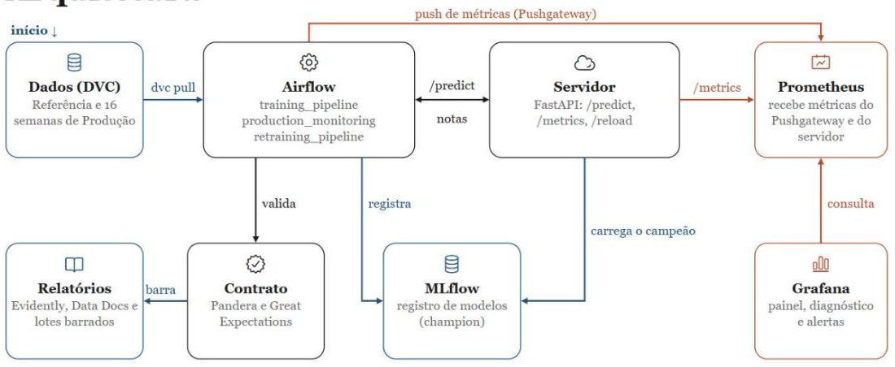

**Em ambiente real**, a mesma cadeia se mantém, com cada etapa reforçada: ingestão com contrato de dados e data lake com acesso
por perfil e criptografia, treino em computação elástica, registro de modelos com aprovação humana e model card, serviço com
vários servidores e implantação em canário, monitoramento preparado para rótulos que levam meses, alertas para um plantão com
runbook e fallback para lotes bloqueados. Neste projeto, cada etapa é uma versão enxuta: um servidor, um portão de promoção
automático e rótulos com uma semana de atraso.

### Estrutura do repositório

```
├── config/            # perfil do contrato, variáveis monitoradas, limiares congelados
├── src/credit_drift/
│   ├── contracts/     # Pandera, Great Expectations, regras e lote corrompido
│   ├── drift/         # cronograma, modelo de rótulos e simulador das 16 semanas
│   ├── training/      # features, modelos, busca (Optuna), campeão, MLflow
│   ├── monitoring/    # PSI/KS, Evidently, alertas, diagnóstico, fatias, causal, viés, laço semanal
│   ├── retraining/    # janela, candidatos, portão de bootstrap, política
│   └── serving/       # app FastAPI e leitura do registro
├── dags/              # training_pipeline, production_monitoring, retraining_pipeline
├── docker/            # Dockerfiles, Prometheus e Grafana (painel provisionado)
├── notebooks/         # 01_eda, 02_retraining, 04_drift_evaluation (executados; HTML em docs/reports)
├── tests/             # 130 testes
├── data/              # ponteiros do DVC; os dados ficam no remoto S3, fora do git
├── docker-compose.yml
└── docs/              # decisions.md, build-plan.md, operations.md, calibration/, reports/, img/
```

## Dados e simulação de drift

O conjunto é o **Home Credit Default Risk** (`application_train.csv`, 307 mil linhas, 8,1% de inadimplentes), só a tabela
principal. Ele é dividido em **Referência** (treino) e **Produção** (separada, sem sobreposição). A Produção (100 mil linhas) é
cortada em **16 semanas** de 5.000 clientes, e um estado de "mundo" é aplicado a cada semana
(`uv run python -m credit_drift.drift.simulate`; decisão #10). O tempo é sintético. Cada semana tem sua semente e um estado
absoluto (não acumulado), então acrescentar uma semana não altera as anteriores. `docs/reports/drift_spec.json` registra o que foi
injetado e só é usado offline.

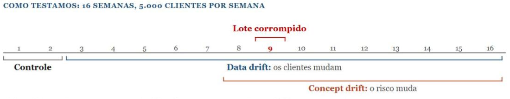

| Semanas | O que acontece |
|---|---|
| 1–2 | controle: nenhum drift |
| 3–4 | drift gradual de covariáveis: renda ×0,90 → ×0,86 e tempo de emprego ×0,92 → ×0,85; a mistura de tipos de renda começa a mudar |
| 5 | choque abrupto: parcela ×1,15 e mistura completa (pensionistas de 18% para 12%) |
| 6–7 | novo normal: o regime da semana 5 continua |
| 8, 10–16 | **concept drift**: para clientes até 45 anos com renda abaixo da mediana (≈26%), a relação de `EXT_SOURCE_2` com a inadimplência é invertida e reduzida à metade; o deslocamento das entradas continua, então os dois problemas convivem |
| 9 | lote corrompido (12% de rendas nulas, idades < 18, IDs duplicados, coluna numérica como texto), bloqueado pelo contrato; os rótulos nunca chegam |

Efeito no campeão: o drift de covariáveis eleva a probabilidade média prevista (8,2% → 9,0%, com a inadimplência observada
acompanhando) e quase não muda o AUC-PR; o de conceito não move nenhuma distribuição, mas derruba o AUC-PR (AUC-ROC de 0,76–0,78
para 0,72–0,74). Uma semana de 5.000 clientes é ruidosa (IC do AUC-PR de ±0,04), por isso as métricas por fatia usam janelas de
duas semanas.

## Modelo campeão

O treino roda em quatro experimentos do MLflow, cada um alimentando o seguinte (decisão #8):

```bash
docker compose up -d                                  # MLflow + Postgres
uv run python -m credit_drift.training.run all        # ou: features | models | tune | select
```

| Experimento | O que compara | Resultado |
|---|---|---|
| `feature_engineering` | variantes A (bruta), B (engenhada), C (selecionada), com regressão logística e LightGBM | **B** vence (AUC-PR 0,2402); A é pior (0,2333) |
| `model_selection` | regressão logística, LightGBM e XGBoost na variante B | LightGBM e XGBoost empatam (0,2402 e 0,2404) |
| `hyperparameter_tuning` | Optuna (TPE, 25 tentativas por família) | empate (0,2462 em validação cruzada) |
| `champion` | seleção, calibração, teste único, registro | **variante B + LightGBM**, calibração de Platt |

**Regra de seleção:** ordenar por AUC-PR em validação cruzada de 3 partes, manter tudo a até 1 erro-padrão do melhor e escolher o
de menor custo esperado; o Brier é uma verificação de sanidade (o modelo calibrado precisa superar o palpite constante).

**Campeão no teste da Referência** (usado uma vez): AUC-PR 0,246 (IC 95% 0,232–0,261), AUC-ROC 0,760, Brier 0,0680 (constante:
0,0745), probabilidade média prevista 8,09% (observada 8,10%). No limiar de 1/6, sinaliza 12% dos solicitantes e captura 38,5%
dos inadimplentes, com 26% de precisão. O modelo é registrado no **MLflow Model Registry** com o alias `champion`, o único
usado adiante.

## Contrato de dados

Dois validadores com papéis distintos (`src/credit_drift/contracts/`): **Pandera**, porta de entrada rápida só com as regras
bloqueantes, e **Great Expectations**, com a suíte completa e as **Data Docs** (trilha de auditoria).

| Severidade | Regras | Efeito |
|---|---|---|
| Bloqueante | colunas e tipos; `SK_ID_CURR` único e não nulo; renda não nula e > 0; idade 18–100; `DAYS_EMPLOYED` ≤ 0 ou o código 365243; valores de crédito positivos | o lote é rejeitado e não é pontuado |
| Aviso | renda > 10 milhões (tolerância de 0,1%); gênero fora de {F, M, XNA}; aumento de mais de 5 pontos na taxa de nulos; categorias nunca vistas; tamanho do lote | registrado e alertado; o lote segue |

Há dois contratos: o do lote de pontuação (sem `TARGET`) e o dos rótulos, aplicado quando amadurecem. Os resultados registram só
contagens e percentuais, nunca valores (LGPD).

**Resultado.** O lote corrompido da semana 9 é rejeitado pelos dois validadores, vai para a quarentena, dispara alerta crítico e
o modelo nunca o vê; sem o contrato, 12% das notas sairiam sem renda. Em um cenário real, um lote bloqueado teria fallback
(segurar as decisões, revisão manual ou pontuar só as linhas válidas); aqui ele só é barrado.

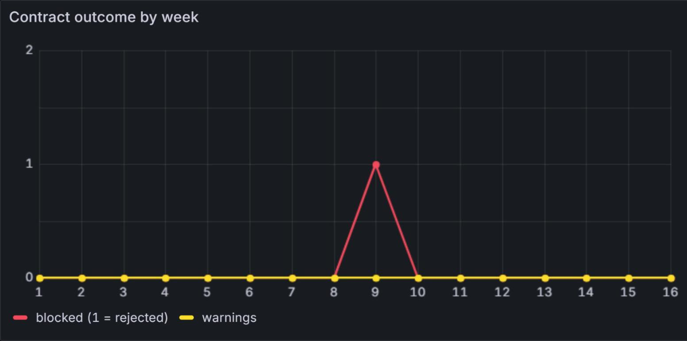

**Onde ver:** `docs/reports/data_docs/index.html`, `uv run python -m credit_drift.contracts.demo` e o painel "Contract outcome by week".

## Data drift e PSI

Cada semana, depois do contrato, é pontuada pelo campeão e comparada com duas bases
(`uv run python -m credit_drift.monitoring.run_drift`; decisão #11): a **Referência original** (informativa) e a **janela de
treino do campeão** (dispara os alertas e muda quando um novo modelo é promovido). São medidos PSI, KS, qui-quadrado e
Jensen-Shannon em todas as colunas de entrada (inclusive as derivadas, como parcela/renda) e no score. **O PSI decide os alertas**
(< 0,10 estável, 0,10–0,25 moderado, > 0,25 forte), porque mede o tamanho da mudança, enquanto com milhares de linhas o p-valor
acusa qualquer diferença.

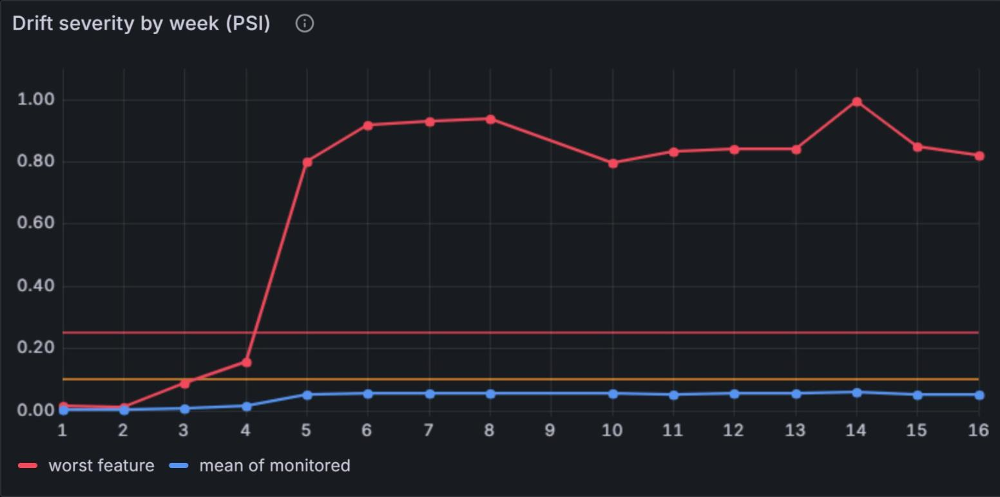

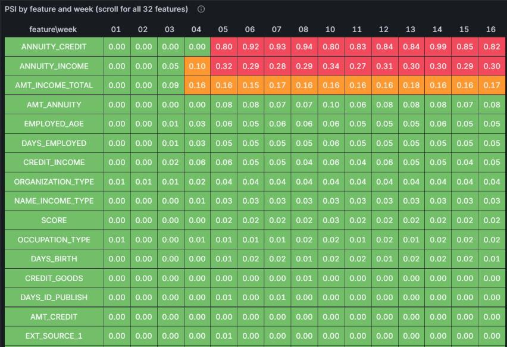

O painel ordena as variáveis pelo PSI; a captura mostra as 16 primeiras das 32 monitoradas.

**Resultado.** Nas semanas de controle o PSI máximo é 0,012. A renda passa de 0,10 na semana 4 (0,156), e a partir da semana 5 três
variáveis passam do limite, duas fortes: parcela/crédito (0,80–0,94) e parcela/renda (0,27–0,34). A parcela bruta sozinha (PSI
0,08) teria escondido o choque; as razões financeiras o revelam. As semanas de concept drift são idênticas às 5–7 para todos os
detectores de distribuição, e nessa fase o AUC-PR observado (0,261) ficou igual ao esperado só pelas entradas (0,262): o PSI diz
o que mudou, não se o modelo piorou.

**Relatórios Evidently** (semanas 1, 5 e 8 em `docs/reports/drift/`). Cada um tem dois quadros "Dataset Drift" sobre as mesmas 33
colunas (32 variáveis e o score), com réguas diferentes, explicadas numa caixa no topo do relatório:

| | Quadro 1: **PSI** | Quadro 2: **KS e qui-quadrado** |
|---|---|---|
| Mede | o tamanho da mudança (10 faixas de mesma frequência na base) | se a diferença existe (p-valor) |
| Coluna "drifted" | PSI ≥ 0,10 | p < 0,05 |
| Acusa drift quando | pelo menos 1 coluna passa (a regra de alerta) | metade das colunas passa (padrão do Evidently) |
| Semana 1 / semanas 5 e 8 | 0 de 33 / 3 de 33 | 4 de 33 por acaso / 15 de 33 |

O padrão de 50% do Evidently nunca dispararia com 3 de 33 variáveis, por isso no quadro do PSI o limite foi ajustado para 1
coluna; no de KS e qui-quadrado ele foi mantido, e esses testes servem como segunda opinião, não como alerta.

## Concept drift e desempenho

O concept drift não aparece nas entradas: só o AUC-PR mostra, e só quando os rótulos chegam, uma semana depois. O AUC-PR cai na
semana 8 e fica perto de 0,19 (a linha verde é a base de 0,246). A semana 9 não tem ponto (lote bloqueado) e a 16 ainda não tem
rótulos no monitoramento semanal. A calibração, ao contrário, se mantém: a taxa prevista acompanha a observada.

<table>
<tr>
<td>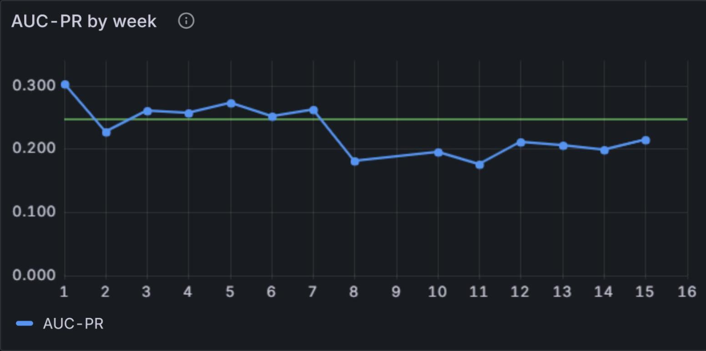</td>
<td>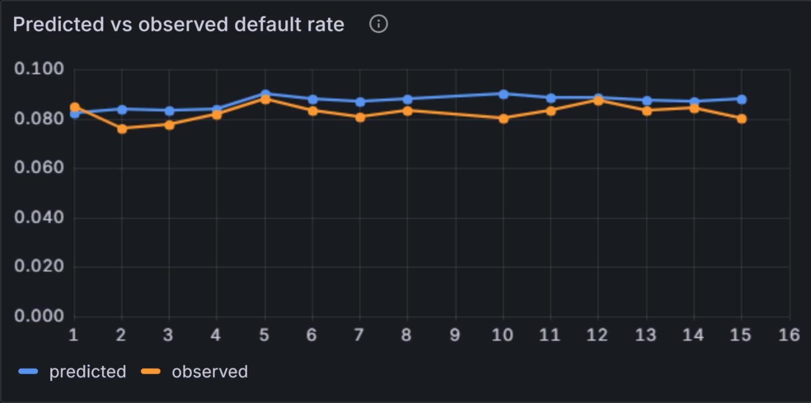</td>
</tr>
</table>

A matriz de fatias mostra a queda de AUC-PR por fatia e semana, contra a base do próprio campeão. As fatias de idade baixa, renda
baixa e `EXT_SOURCE_2` baixo (as que definem o segmento injetado) são as piores a partir da semana 8.

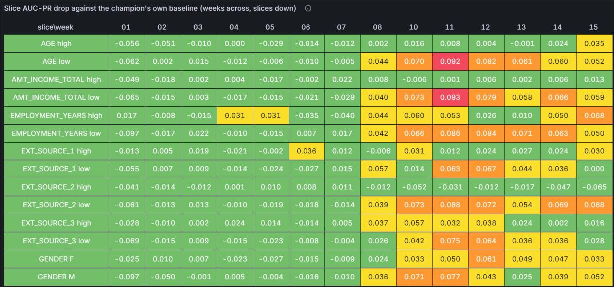

**Calibração dos limiares.** Os limiares foram calibrados offline em simulações com outras sementes (101 e 202 para escolher, 303 e
404 para validar uma vez; `notebooks/04_drift_evaluation.ipynb`, decisão #16): nenhum falso alarme no controle, concept drift
detectado em 5/5 e 4/5 semanas e diagnóstico correto em 13/13 e 12/13. A regra de desempenho usa a **média de 3 semanas** do
AUC-PR (margem de 1,645 erro-padrão), porque uma semana isolada tem o ruído do tamanho da queda. Limitações: a semana 8 pode ser
detectada com um a dois semanas de atraso, o alerta de fatia é fraco e as quatro sementes vêm do mesmo simulador. O uso da verdade
do simulador nessa calibração é uma exceção aprovada.

## Causalidade

O objetivo é separar "os clientes mudaram" de "o risco mudou". Com o simulador, comparamos a causa injetada, a atribuída pelos
detectores e a estimada por contrafactual (`notebooks/04_drift_evaluation.ipynb`; só offline).

**Contrafactual por reponderação de importância** (`monitoring/causal.py`, `docs/calibration/counterfactual.json`). Reponderamos a
Referência, com uma regressão logística que distingue treino de produção, para que suas variáveis se pareçam com as da produção,
e medimos o AUC-PR do campeão nela: é o que as entradas deslocadas, sozinhas, produziriam.

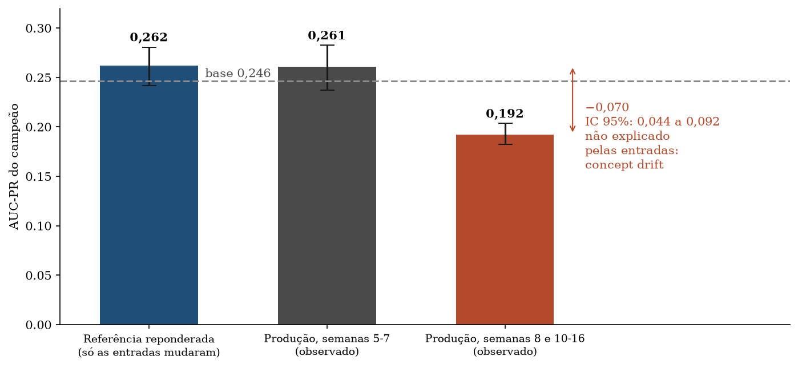

| | AUC-PR | IC 95% |
|---|---|---|
| Referência (base) | 0,246 | 0,233 a 0,260 |
| Referência reponderada (efeito das entradas) | 0,262 | 0,242 a 0,281 |
| Produção, semanas 5–7 (só covariáveis) | 0,261 | 0,237 a 0,283 |
| Produção, semanas 8 e 10–16 (concept drift) | **0,192** | 0,182 a 0,203 |

Nas semanas 5–7 as entradas explicam tudo (diferença de 0,002, IC que inclui zero). Nas semanas de conceito as variáveis são as
mesmas, e ainda assim o AUC-PR fica **0,070** abaixo do que as entradas dariam (IC 95% 0,045 a 0,092): **a causa da queda é o
concept drift**. A queda total sobre a base é de 0,054; o 0,070 é medido contra os 0,262 esperados. Ressalvas: o método assume que
o risco de um mesmo perfil não mudaria, então é uma atribuição e não uma prova causal; o IC é um bootstrap de 200 sorteios sobre
as linhas, sem a incerteza do modelo de pesos; e o esperado (0,262) acima da base (0,246) provavelmente vem da mudança de
composição da população, mas não separamos os efeitos. Não calculamos o contrafactual nas semanas de controle nem nas 3–4 como
verificação de sanidade.

**Injetado contra detectado** (PSI ≥ 0,10): precisão de 100% (nenhum falso positivo em 16 semanas) e **recall de ≈ 0,38**. Dos
oito sinais injetados ou derivados, o PSI nomeia três (parcela/crédito, parcela/renda e renda); o tempo de emprego (PSI ≈ 0,05) e
a mistura de tipos de renda (≈ 0,03) mudaram, mas ficam abaixo do limite. O diagnóstico semanal acerta 14 das 15 semanas
avaliáveis. A atribuição é validada contra um simulador; em produção, a causa teria de ser investigada com dados de negócio.

Recalibrar não muda o AUC-PR, e reajustar o modelo só ajuda depois de várias semanas rotuladas do regime novo (veja
[Retreino](#retreino-e-recalibração)).

## Monitoramento semanal e painel

O DAG **`production_monitoring`** executa uma semana simulada por vez (as 16 rodam em cerca de 25 minutos, com os retreinos). Por
semana: o lote passa pelo contrato (se rejeitado, vai para a quarentena e não é pontuado); se passar, é pontuado pelo servidor
via HTTP e gera o relatório de drift. Como os rótulos chegam com uma semana de atraso, a execução da semana N fecha a semana N-1
(AUC-PR, Brier, taxa prevista contra observada e 14 fatias). Em seguida vêm as regras de alerta, o diagnóstico do tipo de drift
(comparando com a semana anterior, não com a Referência), o registro no MLflow e o envio ao Pushgateway/Prometheus (decisão #14).
O Airflow 3 roda no servidor Linux (`docker compose`, perfil `airflow`); as tarefas só chamam `python -m credit_drift...`.

O **painel do Grafana**, provisionado como código (`docker/grafana/build_dashboard.py`; decisão #15), organiza a história em três
atos: os dados são válidos (contrato e saúde do servidor), as entradas mudaram (PSI, score) e o modelo piorou (AUC-PR, Brier,
taxa prevista contra observada), e uma linha recolhida guarda fatias, diagnóstico e alertas. Os painéis que dependem de rótulos
só mostram a semana N depois da N+1.

As tabelas de diagnóstico e de alertas resumem o laço (limiares congelados, decisão #17): controle sem alertas; semana 3 já
diagnosticada como covariáveis; primeiro alerta (`data_drift_moderate`) na 4 e `data_drift_major` a partir da 5, repetido até a
16 porque a base de alerta só muda com a promoção de um novo modelo; semana 9 com `batch_blocked` e diagnóstico "técnico";
`performance_drop` e diagnóstico de concept drift a partir da 10. A semana 8 não é diagnosticada, porque a média móvel de 3
semanas ainda não caiu (atraso aceito, decisão #16).

<table>
<tr>
<td>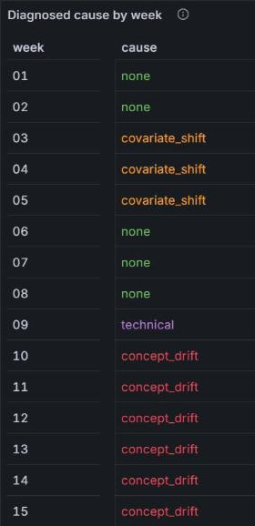</td>
<td>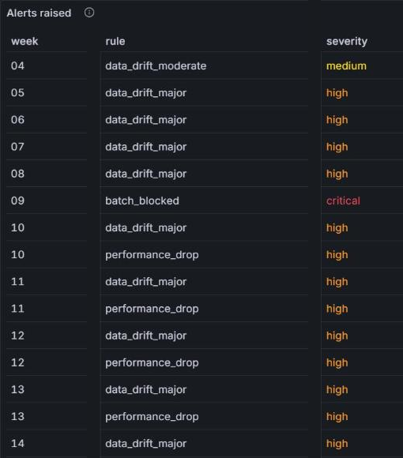</td>
</tr>
</table>

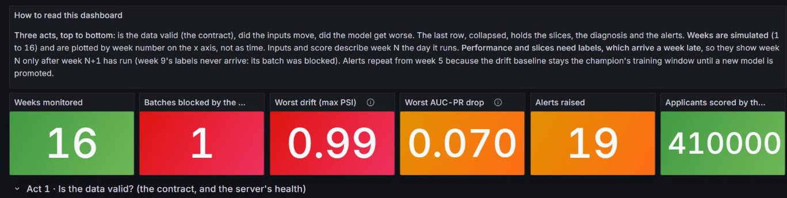

**Métricas de saúde** (Prometheus: Pushgateway para as tarefas em lote, `/metrics` para o servidor):

| Dimensão | Métricas |
|---|---|
| Pipeline | estado das tarefas no Airflow, `batch_blocked`, `batch_contract_warnings`, `batch_rows` |
| Servidor | `predict_requests_total`, `predict_rows_total`, `predict_latency_seconds` (p95), `model_info`, `model_reloads_total` |
| Drift | `drift_max_psi`, `drift_mean_psi`, `drift_n_psi_moderate/major`, `drift_score_psi/ks`, `drift_feature_psi/ks` |
| Desempenho (com rótulos) | `model_auc_pr`, `model_brier`, `model_mean_pred`, `model_observed_rate`, `slice_auc_pr` |
| Alertas | `alert_firing{rule,severity}`, `diagnosis{cause}` |

Os logs ficam no Airflow (por tarefa e tentativa) e cada semana gera uma execução no experimento `production_monitoring` do MLflow.

**Servidor do modelo** (FastAPI, porta 8010): carrega `models:/credit_scoring@champion` do registro. `POST /predict` devolve a
probabilidade e `high_risk` (acima do limiar), validando cada requisição com o mesmo contrato do lote (violação devolve 422 com
coluna, regra e contagem, nunca valores); `GET /metrics` expõe as métricas Prometheus; `POST /reload` (cabeçalho
`X-Reload-Token`) troca o modelo sem reiniciar e mantém o anterior se falhar; `/health`, `/ready` e `/model` completam a
operação. O limiar de 1/6 fica como *tag* da versão no MLflow, e `high_risk` é uma sinalização para análise, não uma recusa
automática. Medido no contêiner: 5.000 clientes em 0,68 s.

## Retreino e recalibração

É uma **extensão**: o enunciado não exige retreino. O `retraining_pipeline` roda dentro do laço, com um atraso de rótulos de uma
semana: dispara no primeiro alerta forte de drift de dados (semana 5, rótulos até a 4) e nos alertas de queda de desempenho
(semanas 11 e 14, com carência de três semanas rotuladas). Cada execução constrói dois candidatos, **A** (o campeão recalibrado)
e **B** (a mesma receita reajustada na Referência mais as semanas rotuladas, com mais peso nas recentes, e recalibrada). Um
**portão de bootstrap pareado** (fatia separada de 8 mil linhas, 1.000 sorteios, IC de 97,5%) exige que o **ganho de custo
esperado** (C_FN = 5 × C_FP) tenha o intervalo inteiro acima de zero, sem piora significativa de AUC-PR. Se um passar, o alias
`champion` muda e o servidor recarrega; o primeiro campeão continua pontuando offline como linha de comparação (exceção aprovada).

**Resultado.** O portão rejeitou os candidatos nas três tentativas, e o campeão original serviu as 16 semanas. O gráfico mostra a
diferença de AUC-PR do candidato B contra o campeão na fatia do portão (quem decide é o custo esperado, que também não passou).

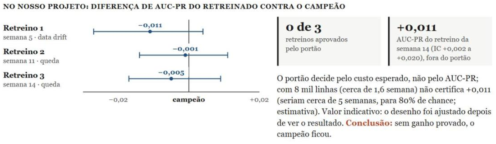

Depois do drift de covariáveis, recalibrar foi neutro e reajustar com 4 semanas foi pior (AUC-PR −0,010). Depois de cinco semanas
rotuladas de concept drift, o candidato B **melhora de fato** nas semanas 14–16, que nenhum modelo viu: AUC-PR +0,011 (IC 95%
+0,002 a +0,020), concentrado no segmento afetado (0,189 → 0,216). O portão não o aprovou: na fatia dele a estimativa foi −0,005
(IC −0,017 a +0,009). Com 8 mil linhas (cerca de 1,6 semana), provar +0,011 com 80% de poder pediria cerca de 5 semanas
(estimativa); em produção isso pede um período de sombra mais longo, não implementado aqui. O desenho do retreino foi ajustado
depois de ver resultados (post hoc), o que torna o +0,011 indicativo e não um teste limpo, e o caminho de promoção (alias,
recarga, nova base de drift) só foi exercitado em testes unitários. Análise em `notebooks/02_retraining.ipynb`, decisão #18.

## Governança e LGPD

> **Ressalva.** O conjunto de dados é público (Home Credit, Kaggle) e não identifica titulares brasileiros: a LGPD não se aplica a
> ele em si. O projeto o trata **como se** fossem dados de clientes de uma fintech brasileira, e este plano descreve o que seria
> feito em produção. É documentação de engenharia, **não parecer jurídico**: os pontos marcados com (*) pedem validação do
> jurídico e do encarregado (DPO).

| Princípio da LGPD | O que o projeto faz | Situação |
|---|---|---|
| Minimização (art. 6º, III) | Gênero, ID e alvo fora das entradas do modelo; servidor, contrato de dados e relatórios mostram regras, contagens e agregados (só a quarentena guarda linhas de clientes) | Implementado |
| Segurança e rastreio (art. 46) | Dados fora do git (DVC); painéis só em 127.0.0.1, via túnel SSH; commit, hash dos dados (execuções de ajuste) e janela de treino (retreinos) no MLflow | Implementado |
| Não discriminação (art. 6º, IX) | Auditoria por gênero e idade e monitoramento semanal por fatia; mitigação e justificativa do uso da idade ficam para o jurídico; nenhum alerta por fatia disparou e a mitigação não foi testada | Parcial |
| Retenção (arts. 15 e 16) | Lote rejeitado isolado em quarentena (semana 9); prazos propostos, sem rotina que apague | Parcial |
| Base legal e revisão (arts. 7º e 20) | Base legal por finalidade; escore como recomendação, com revisão por analista | Descrito |

**Inventário.** `SK_ID_CURR` é uma chave pseudonimizada (sem nome, CPF ou contato) e nunca entra no modelo. Idade, renda, emprego,
escolaridade, ocupação e dados do crédito são dados pessoais comuns (art. 5º, I). `CODE_GENDER` tem risco de discriminação e
**não é entrada do modelo** (`training/features.py`); fica no dado só para a auditoria de viés. `EXT_SOURCE_1/2/3` vêm de
terceiros, e sua origem e base legal precisam ser rastreáveis (*). Nenhuma coluna é dado sensível (art. 5º, II), então o art. 11
não se aplica.

**Tratamento no projeto.** O git guarda só ponteiros do DVC; os dados ficam num bucket S3 privado (acesso público bloqueado,
criptografia em repouso, usuário IAM restrito). Relatórios, notebooks, métricas e logs guardam agregados. A **quarentena**
(`artifacts/monitoring/quarantine`) **contém linhas de clientes**, não tem permissão restrita nem rotina de remoção: o acesso
restrito e a retenção curta são propostas (*). A rastreabilidade (art. 6º, X e 37) vem de `mlflow.log_input()` (hash do conjunto
de dados nas execuções de ajuste), do registro de modelos, do DVC por semana e das Data Docs; não há trilha de quem aprovou uma
promoção, porque ela é automática pelo portão. Não há credenciais no repositório.

| Tratamento | Base legal (art. 7º) | Observação |
|---|---|---|
| Avaliar o pedido e pontuar o cliente | **V** (execução de contrato) e **X** (proteção ao crédito) | consentimento seria frágil, pois pode ser revogado |
| Monitorar e melhorar o modelo | **IX** (legítimo interesse) | exige teste de balanceamento e minimização (*) |
| Guardar registros para auditoria | **II** (obrigação legal ou regulatória) | prazos definidos pela regulação aplicável (*) |

**Decisão automatizada (art. 20) e direitos (art. 18).** O escore é uma recomendação (`high_risk` quando a probabilidade atinge
1/6) e a decisão final deve ter revisão por analista; esse fluxo **não está implementado** (*). Os dados são versionados por
semana, então um titular que peça eliminação pode ser retirado da janela do próximo retreino (`retraining/window.py`), e modelos
já treinados deixam de conter o dado depois dele (*).

**Retenção proposta (*).** Dados brutos e Referência: enquanto durar a finalidade e a obrigação legal. Lotes semanais: até a maior
janela de retreino (12 meses). **Lote em quarentena: 30 dias.** Escores por cliente: prazo de auditoria e de revisão (art. 20).
Logs do pipeline: 90 dias. Métricas, relatórios, notebooks e modelos não têm dado pessoal e podem ser mantidos como evidência.

### Auditoria de viés

Viés aqui é o modelo errar mais para um grupo do que para outro, mesmo sem usar a característica (discriminação indireta, art. 6º,
IX). Medimos por grupo, no limiar de 1/6, no teste da Referência (não em produção; `monitoring/fairness.py`,
`docs/calibration/fairness.json`): **calibração** (previsto contra observado), **taxa de sinalização** (de 100 do grupo, quantos
são barrados), **taxa de falso positivo** (de 100 que pagariam, quantos são barrados) e **recall**.

| Grupo | Clientes | Observada | Prevista | Sinalizados | Falso positivo | Recall |
|---|---|---|---|---|---|---|
| Mulheres | 27.387 | 7,0% | 7,4% | 9,9% | 8,1% | 35,0% |
| Homens | 14.116 | 10,2% | 9,4% | 16,1% | 13,0% | 43,3% |
| 18 a 29 anos | 6.021 | 11,9% | 12,0% | 23,8% | 19,9% | 52,8% |
| 30 a 44 anos | 16.744 | 8,9% | 8,8% | 14,0% | 11,3% | 41,9% |
| 45 a 59 anos | 13.967 | 6,7% | 6,6% | 7,8% | 6,3% | 29,1% |
| 60 anos ou mais | 4.771 | 4,7% | 4,9% | 2,5% | 2,1% | 9,9% |

A **calibração se mantém em todos os grupos** (12,0% previsto e 11,9% observado de 18 a 29 anos), mas as **taxas de erro
diferem**: os homens são sinalizados 1,61 vez mais e têm mais falsos positivos (13,0% contra 8,1%); os mais jovens são
sinalizados cerca de 9 vezes mais que os mais velhos (falsos positivos de 19,9% contra 2,1%). Em boa parte isso acompanha a
inadimplência real de cada grupo, mas não é possível igualar todas as métricas quando as taxas de base diferem: é preciso
escolher qual igualdade perseguir e justificar a escolha, e isso é decisão do jurídico e do comitê de risco (*). A idade é
entrada do modelo e pede justificativa e base legal (*); o gênero não é. Não foram feitos, por exigirem decisão de negócio e
jurídica: remover variáveis proxy, reponderar o treino e limiares por grupo (que podem ser discriminatórios). Só há gênero
binário no dado, e outras características (estado civil, escolaridade) não foram auditadas.

## Conclusão

**O que encontramos.**

1. **Contrato de dados:** barrou o lote corrompido da semana 9 antes do modelo; sem ele, 12% das notas sairiam sem renda.
2. **Data drift:** PSI de 0,01 para 0,80 na semana 5 (parcela/crédito), sem falsos alarmes e sem queda de desempenho (0,261
   observado contra 0,262 esperado).
3. **Concept drift:** só o desempenho mostra; o AUC-PR caiu de 0,246 para cerca de 0,19, e 0,07 não vêm das entradas (IC 95%
   0,045 a 0,092).
4. **Retreino (extensão):** 0 de 3 candidatos passaram no portão; o ganho de +0,011 é indicativo e pediria cerca de 5 semanas de
   dados para ser provado com 80% de poder (estimativa).
5. **Governança e viés:** privacidade e rastreio no código; retenção, base legal e revisão humana apenas descritas; erros
   desiguais por grupo (de 100 clientes de 18 a 29 anos que pagariam, 20 são barrados, contra 2 com 60 anos ou mais).

**Limites.** Dados simulados por um único simulador; causa validada contra o simulador; prazos e bases legais dependem de
validação jurídica; o lote bloqueado não tem plano de contingência.

**Decisões principais** (completas em `docs/decisions.md` e `CLAUDE.md`):

| Decisão | Por quê | Onde |
|---|---|---|
| Experimentos em etapas, regra de custo 5:1, campeão calibrado | seleção reproduzível e ligada a custo | #8, #9 |
| 16 semanas, simulação por estado absoluto, sementes por semana | um retreino precisa de cinco semanas rotuladas de concept drift; semanas não mudam quando outras são acrescentadas | #10 |
| PSI como sinal de alerta, KS e χ² como evidência; duas bases | o PSI mede o tamanho da mudança; a base de alerta acompanha o modelo promovido | #11 |
| Push (Pushgateway) e pull (`/metrics`) | mostrar os dois padrões de coleta | #15 |
| Limiares calibrados offline em outras sementes e congelados | não ajustar os limiares ao resultado oficial | #16 |
| Portão de bootstrap pareado, sem margem fixa; v1 segue pontuando offline | só promover ganho provado; v1 é a linha de comparação (exceção aprovada) | #18 |

**Trabalho futuro.** Implantação na AWS (EC2 com a pilha, Elastic Beanstalk para o servidor, S3) com roteiro de subir e derrubar,
não feita; retenção automática da quarentena; plano para lote bloqueado; fluxo de revisão humana (art. 20); mitigação de viés e
justificativa do uso da idade; período de sombra mais longo para certificar ganhos pequenos de um retreino.

## Reprodução completa e operação

Pré-requisitos: git, [uv](https://docs.astral.sh/uv/) e Docker Desktop. `uv sync` instala o Python 3.14 e as dependências
travadas; `uv run pytest` roda os 130 testes (cerca de 5 minutos).

**Dados (escolha uma opção).**

- **A, sem AWS (recomendada):** baixe `application_train.csv` e `HomeCredit_columns_description.csv` da competição
  [Home Credit Default Risk](https://www.kaggle.com/competitions/home-credit-default-risk/data) (aceitando as regras) para
  `data/raw/` e confira com `uv run dvc status data/raw/application_train.csv.dvc data/raw/HomeCredit_columns_description.csv.dvc`. O restante (Referência e semanas simuladas) é regenerado pelo
  código com sementes fixas: `uv run python -m credit_drift.split` e `uv run python -m credit_drift.drift.simulate`.
- **B, bucket S3 próprio:** o remoto padrão do DVC é privado e `dvc pull` falha para terceiros, de propósito. Use
  `uv run dvc remote modify --local s3store url s3://SEU-BUCKET/dvc-store` (credenciais suas em `~/.aws/credentials`) e
  `uv run dvc push` depois da opção A.
- **C, autor:** credenciais do usuário IAM do projeto em `~/.aws/credentials` e `uv run dvc pull`.

**Pilha e passos.**

```bash
docker compose up -d                                          # Postgres, MLflow e servidor do modelo
uv run python -m credit_drift.training.run all                # experimentos e campeão
docker compose --profile airflow --profile monitoring up -d   # Airflow, Pushgateway, Prometheus e Grafana
# no Airflow: dispare training_pipeline e depois production_monitoring (uma execução por semana simulada)
uv run python -m credit_drift.monitoring.run_drift            # relatórios de drift (docs/reports/drift/)
```

O estado do MLflow fica em um volume Docker local e não é compartilhado entre máquinas: o treino é reexecutado em cada ambiente,
com sementes fixas. O README usa capturas do Grafana e dos slides; `scripts/make_readme_figures.py` gera a figura do
contrafactual.

**Operação.** A pilha roda num servidor Linux (alias SSH `pricing-server`) com as interfaces só em localhost, acessadas por túnel
SSH (detalhes em `docs/operations.md`):

```bash
ssh -N -L 5000:localhost:5000 -L 8010:localhost:8010 -L 8080:localhost:8080 -L 3000:localhost:3000 -L 9090:localhost:9090 pricing-server
```

MLflow em `:5000`, servidor do modelo em `:8010`, Airflow em `:8080`, Grafana em `:3000` (leitura anônima, só pelo túnel) e
Prometheus em `:9090`.

**Onde ver cada resultado.** Validação: `docs/reports/data_docs/index.html`. Drift por semana: `docs/reports/drift/` e o mapa de
calor do Grafana. Modelos e registro: MLflow. Retreino: `notebooks/02_retraining.ipynb`. Detectores contra o injetado:
`notebooks/04_drift_evaluation.ipynb` (HTML de ambos em `docs/reports/`). Execução dos DAGs: Airflow. História das 16 semanas:
Grafana.
